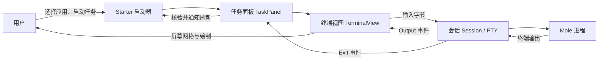
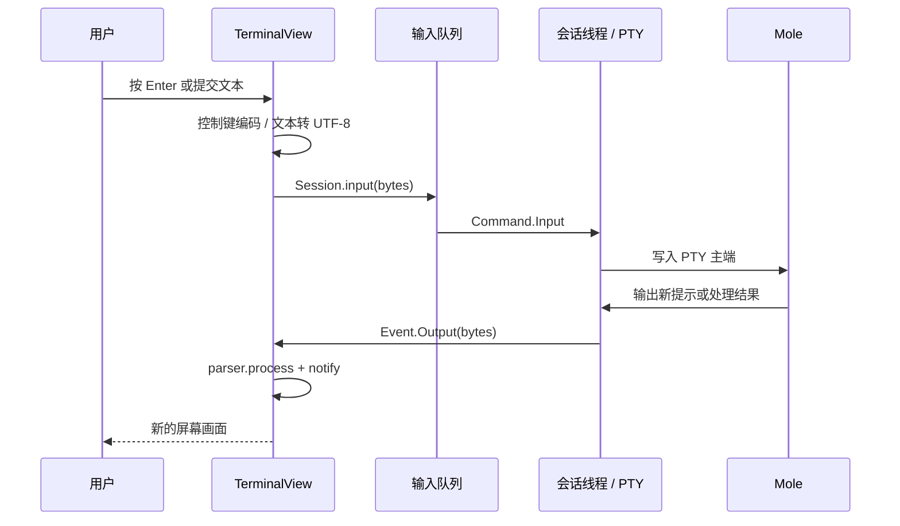
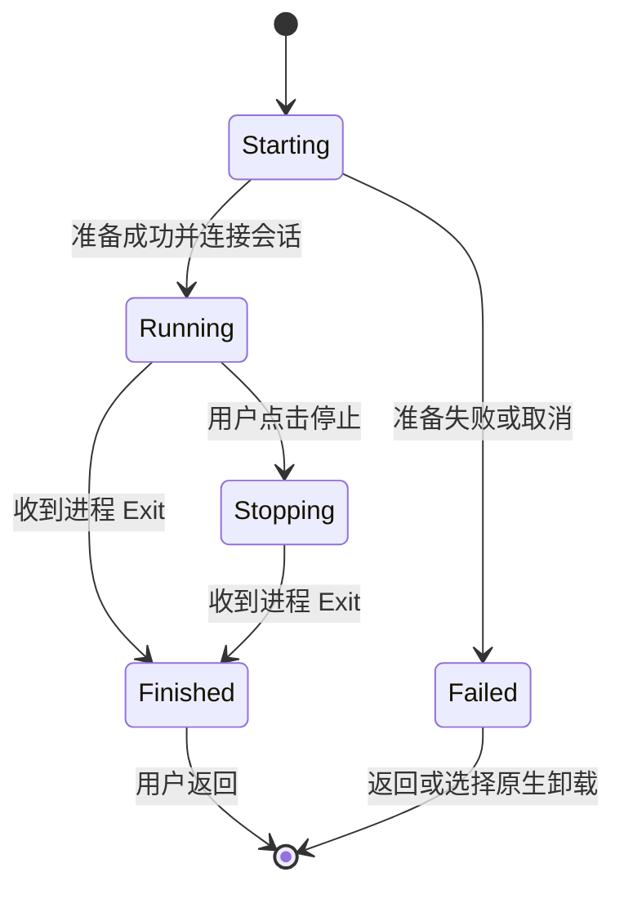

# 从零读懂 Starter 的内嵌卸载终端

这是一份沿着真实代码阅读的教程。我们从“点击卸载后发生了什么”讲起，再进入进程、终端、界面和任务管理，最后用两个不会删除应用的小实验练习实现。

不要求你事先熟悉 GPUI、PTY 或终端协议。需要先接受一个基本事实：**窗口里显示的内容、后台运行的程序、连接双方的输入输出，是可以分别实现的。**

本文对应当前工作区中的首版实现。代码链接指向这台机器上的真实文件；以后代码行号变化时，可以按函数名定位。教程中的“代码摘录”来自当前实现；标为“简化示意”的片段只用于理解；最后的两份“可运行实验”可以独立保存并运行。

## 阅读路线

建议读三遍。第一遍读第 1～3 课和第 11 课，建立整体认识。第二遍按课程打开代码，沿着一次任务走完。第三遍做第 12 课的实验与第 13 课的练习，检查自己能否重新实现。

| 课程 | 要回答的问题 | 学完后能做什么 |
| --- | --- | --- |
| 1 | 我们究竟做了什么？ | 说清 Starter 与 Mole 各自负责什么 |
| 2 | 代码分布在哪里？ | 找到每层入口，读懂常见 Rust 写法 |
| 3 | 点击按钮怎么变成任务？ | 跟踪应用选择、面板创建与后台准备 |
| 4 | 怎么准确交给 Mole？ | 实现工具发现、清单读取、参数匹配 |
| 5 | 怎么拥有一条独立终端？ | 理解 PTY、读写线程与消息通道 |
| 6 | 输出为什么不能直接放进文本框？ | 理解 ANSI、屏幕网格与原生绘制 |
| 7 | 键盘和中文怎么送回去？ | 区分控制键、文本输入、组合输入与回显 |
| 8 | 隐藏窗口为何还能继续运行？ | 设计任务所有权、焦点和恢复 |
| 9 | 怎么停止并收干净？ | 处理信号、句柄、子进程与退出等待 |
| 10 | 退出码 0 为什么还不够？ | 区分进程结果、业务结果与列表刷新 |
| 11 | 一次完整操作如何串起来？ | 顺着调用链复述整个系统 |
| 12 | 自己从哪里开始写？ | 运行最小 PTY 与 ANSI 实验 |
| 13 | 怎么知道自己真正理解了？ | 用测试、故障定位和练习验证 |

## 第 1 课：先把窗口和程序分开想

你在 Terminal 或 kitty 里运行 Mole 时，至少有三部分在合作：

1. **Mole 进程**扫描应用、列出关联文件、询问确认、调用卸载操作。
2. **操作系统的终端连接**把按键送给 Mole，把 Mole 输出的字节送回来。
3. **终端应用的界面**解释这些字节，画出文字、颜色、光标和交互界面。

我们把第三部分放进了 Starter，并让 Starter 创建第二部分。第一部分继续使用用户已安装的 Mole。

所以，“内嵌终端”在这里的意思是：Starter 创建自己的终端连接和终端视图，通过它们运行一个外部命令行程序。没有启动 kitty、Terminal、iTerm，也没有接入用户正在使用的 shell 会话。Mole 自己作为脚本运行时仍可能由它声明的解释器执行；这与打开用户的交互 shell 是两回事。



职责也因此明确了：

| 工作 | 当前由谁负责 |
| --- | --- |
| 搜索应用、选择目标 | Starter |
| 窗口、主题、字体、键盘焦点 | Starter |
| 创建 PTY、读取输出、发送输入、管理进程 | Starter |
| 扫描关联文件、显示预览、决定需要哪些确认 | Mole |
| Homebrew 卸载、权限交互、具体清理规则 | Mole 及它调用的工具 |
| 退出后核验应用位置、刷新搜索列表 | Starter |

中间看到的文件清单仍是 Mole 的终端界面。Starter 当前没有把这些行解析成原生文件复选框，也没有从输出关键词猜测“现在可以自动确认了”。

**这一课的检查题：**如果想增加一种新的关联文件扫描规则，应该先查 Mole；如果想改底部“收起任务”按钮的位置，应该查 Starter 的任务面板。

## 第 2 课：认识文件和阅读代码的方法

### 2.1 先认这六个位置

| 文件 | 阅读重点 | 负责的事情 |
| --- | --- | --- |
| [启动器 ui.rs](/Users/mkh/code1/starter/src/ui.rs:722) | `start_mole_uninstall`、`show`、`key_down` | 把卸载任务接入现有产品 |
| [Mole 适配器](/Users/mkh/code1/starter/src/uninstall/mole.rs:52) | `prepare`、`inventory`、`argument_for` | 把所选应用转换为准确的 Mole 请求 |
| [终端会话后端](/Users/mkh/code1/starter/src/task_terminal.rs:95) | `Request`、`Session`、`Event` | PTY、进程、线程、消息与清理 |
| [任务面板](/Users/mkh/code1/starter/src/ui/uninstall_task.rs:55) | `new`、`from_preparation`、`State` | 准备、运行、停止、结果和界面外壳 |
| [终端视图](/Users/mkh/code1/starter/src/ui/task_terminal.rs:104) | `feed`、`render`、`key_bytes` | 终端解析、绘制、输入与复制 |
| [原生 macOS 卸载](/Users/mkh/code1/starter/src/uninstall/macos.rs:18) | `validate`、`revalidate`、`execute` | 目标校验与原生移到废纸篓 |

两个文件都叫 `task_terminal.rs`，但位置不同：根目录下的一个连接进程；`ui` 目录下的一个画界面。遇到问题时先问：“字节没有到，还是字节到了但画错了？”这能直接决定读哪一层。

### 2.2 先学够用的 Rust 写法

下面这些写法会反复出现。暂时不需要掌握 Rust 的全部语言规则。

| 写法 | 在本教程里怎么理解 |
| --- | --- |
| `struct` | 把相关数据放进一个类型，如任务名、状态、路径 |
| `enum` | 表示几种明确情况之一，如 `Starting` 或 `Running` |
| `impl` | 为一个类型定义操作 |
| `Option<T>` | 可能有一个 `T`，也可能没有；`Some` 是有，`None` 是没有 |
| `Result<T>` | 操作成功返回 `T`，失败返回错误；具体错误类型由这里的 `anyhow` 别名提供 |
| `?` | 成功就取出值继续，失败就把错误向调用者返回 |
| `&T` / `&mut T` | 借用某个对象读取 / 修改，不把它拿走 |
| `Vec<u8>` | 一串字节；终端协议通过它传输 |
| `PathBuf` / `OsString` | 文件路径 / 操作系统字符串，适合传程序名和参数 |
| `match` | 按不同状态或事件执行不同分支 |
| `self` / `Self` | 当前对象 / 当前正在定义的类型 |
| `.clone()` | 获得一份克隆；字符串可能复制内容，`Arc` 和 `Entity` 等句柄则共同指向原对象 |
| `.into()` | 转换成上下文需要的类型，例如把字符串转成 `OsString` |
| `#[derive(...)]` | 让编译器生成常用能力，例如 `Clone` 或用于读 JSON 的 `Deserialize` |
| `#[cfg(...)]` | 只在指定条件下编译这段代码，如 macOS 或测试模式 |
| `move` 闭包 | 把闭包需要的数据移进去，方便它以后或在后台执行 |
| `.await` | 等待异步结果；等待期间这个异步任务可以让出执行机会 |
| `Drop` | 对象被释放时自动执行的收尾逻辑 |

例如：

```rust
let Some(target) = self.uninstall_confirmation.take() else {
    return;
};
```

这段代码先从 `Option` 中取出目标，并把原来的位置变成 `None`。没有目标就直接返回。有目标才继续。这里用 `take()`，是因为目标接下来要交给新任务，旧的选择对话框应结束。

再看：

```rust
let prepared = mole::prepare(&prepare_target, &prepare_cancelled)?;
```

意思是“尝试准备 Mole 请求；准备失败，就结束当前准备工作并返回错误”。失败不会沿着这行继续启动卸载。

### 2.3 GPUI 中的几个对象

GPUI 是本项目使用的界面框架：它负责窗口、布局、绘制、输入事件和界面对象的更新。后面看到的 `cx` 是框架交给当前代码的上下文，用来创建对象、修改状态、发出事件或安排任务；`window` 则提供当前窗口的操作，例如设置焦点。

| 对象或方法 | 作用 |
| --- | --- |
| `Entity<T>` | GPUI 管理的一个界面对象句柄；界面状态放在对应的 `T` 中 |
| `cx.new(...)` | 创建这样的对象 |
| `entity.update(cx, ...)` | 进入该对象的更新上下文，修改它的状态 |
| `cx.notify()` | 通知 GPUI 状态变化，需要重新绘制；它本身不直接执行绘图 |
| `cx.emit(event)` | 发出业务事件，供订阅它的上层处理 |
| `Subscription` | 保持订阅有效；释放它会解除相应订阅 |
| `Task<()>` | 一个返回空结果的异步任务句柄；本实现保存它来维持任务运行 |
| `FocusHandle` | 记录哪个组件应该收到键盘输入 |

要分清 `notify` 和 `emit`：前者是“界面需要更新”，后者是“发生了一个上层需要处理的事情”。

后面还会遇到“进程”和“线程”。Mole 是操作系统单独启动的进程；Starter 内部可以有多个线程，同时处理界面和输入输出。后台工作把结果放进通道，界面再取出结果更新自己的状态。可以把通道理解为两个执行方之间传递消息的队列。

## 第 3 课：从用户点击追到后台任务

### 3.1 搜索结果先变成一个明确目标

入口在 [open_selected](/Users/mkh/code1/starter/src/ui.rs:1008)。在卸载模式下，Starter 按选中结果的 `id` 找到对应 `Target`，把它放入 `uninstall_confirmation`，随后显示卸载方式对话框。

`Target` 可以先理解成“这次操作的对象”：它有名称、路径、ID，还保存着原生校验得到的身份信息。用户输入的搜索词可能是简称、中文别名或不完整名称；它不能直接作为卸载参数。

对话框提供两个操作：

- “卸载并清理关联文件”：进入 Mole 任务。
- “仅移到废纸篓”：沿用原生 `Target::execute()`。

### 3.2 Mole 按钮创建 TaskPanel

打开 [start_mole_uninstall](/Users/mkh/code1/starter/src/ui.rs:722)，按这五步读：

1. 已有任务或原生卸载正在执行时，直接返回，避免并行启动。
2. `take()` 取出所选目标，结束旧对话框。
3. `cx.new(...)` 创建 `TaskPanel`，传入目标、当前主题和窗口上下文。
4. 订阅面板的 `Hide`、`Close`、`Finished`、`Trash` 事件。
5. 把面板保存到 `self.uninstall_task`，通知界面刷新。

这个字段不是“画一下就结束”的临时变量。它让 Launcher 持续持有任务面板。后面窗口隐藏时，任务仍然存在，就是从这一步开始的。

### 3.3 面板先准备，再连接终端

继续打开 [TaskPanel::new](/Users/mkh/code1/starter/src/ui/uninstall_task.rs:55)。关键摘录：

```rust
let prepare = cx.background_executor().spawn(async move {
    let prepared = mole::prepare(&prepare_target, &prepare_cancelled)?;
    anyhow::ensure!(!prepare_cancelled.load(Ordering::Relaxed), "任务已取消");
    let (session, events) = Session::start(
        prepared.request,
        Size {
            rows: 18,
            cols: 88,
            ..Size::default()
        },
    )?;
    Ok::<_, anyhow::Error>((session, events, prepared.detail))
});
```

这一块完成两件事：`mole::prepare` 找工具、读清单、对齐目标；`Session::start` 创建 PTY 并启动命令。它们放在后台执行器上，因为清单扫描和进程创建可能等待操作系统，不能占住界面线程。

这里的 `18×88` 是初始终端行列数，后面会根据实际内容区尺寸调整，并不是固定把窗口分成这么多格。

随后 [from_preparation](/Users/mkh/code1/starter/src/ui/uninstall_task.rs:88) 创建终端视图，在 GPUI 异步任务中等待准备结果。成功后把 `Session` 交给视图，状态变为 `Running`；失败时显示原因，状态变为 `Failed`。

**区别：**后台执行器负责运行可能阻塞的准备代码；GPUI 异步任务负责等结果、收事件，并通过 `update_in` 回到界面上下文修改状态。写了 `async` 不会自动把所有阻塞代码变成后台代码。

### 3.4 准备时取消为什么需要一个共享标志

`Arc<AtomicBool>` 是一个能被多个执行方共同查看的布尔标志。

- `Arc` 让面板和后台准备工作共同持有同一份标志。
- `AtomicBool` 让不同线程可以安全地读写它。
- 点击停止或面板释放时设为 `true`。
- 扫描中、启动前、准备结果接入面板时都会检查它。

这能处理一种很常见的异步竞态：“用户刚取消，后台扫描才完成”。后台结果不能因为晚到了，就重新把任务启动起来。

本实现用 `Ordering::Relaxed` 读取这个单独的取消标志。这里没有借这个标志发布另一份需要同步的数据；以后如果标志与其他数据有先后可见性要求，就需要重新分析同步方式。

## 第 4 课：把所选应用准确交给 Mole

这一课读 [mole::prepare](/Users/mkh/code1/starter/src/uninstall/mole.rs:52)。它的返回值是：

```rust
pub struct Prepared {
    pub request: Request,
    pub detail: String,
}
```

`request` 是下一层需要执行的程序与参数；`detail` 是给面板显示的来源和应用大小。它不包含删除文件计划。关联数据的总清理大小要等 Mole 自己展示。

### 4.1 找到一个可执行的 Mole

[find_program](/Users/mkh/code1/starter/src/uninstall/mole.rs:33) 依次检查 Homebrew 常见位置、用户 `.local/bin`、环境 `PATH` 中的绝对目录。

找到候选后，解析符号链接到真实路径，检查它是文件并带执行权限。Homebrew 的 `mo` 常是指向安装目录的链接，解析后的绝对路径可直接启动。

为什么不只写 `Command::new("mo")`？因为从 Finder 或登录项启动的 GUI，其 `PATH` 可能与用户交互终端不同。代码必须自己知道去哪里找工具。

### 4.2 清单扫描使用管道，交互卸载使用 PTY

[inventory](/Users/mkh/code1/starter/src/uninstall/mole.rs:74) 执行只读的 `mo uninstall --list`。当前核对过的 Mole 版本，在 stdout 接到管道时返回 JSON，适合程序读取。

```rust
.stdin(Stdio::null())
.stdout(Stdio::piped())
.stderr(Stdio::null())
```

这里不需要用户交互，因此 stdin 关闭，stdout 用管道取 JSON，stderr 不混进 JSON。

但正式卸载需要键盘确认、终端绘制和可能的权限提示，所以接 PTY。**同一个命令行工具，机器读取接口与人机交互接口可以使用不同连接方式。**

扫描还加了这些限制：

| 限制 | 当前实现 | 目的 |
| --- | --- | --- |
| 超时 | 40 秒 | 避免一直卡在准备阶段 |
| 输出读取上限 | 4 MiB | 避免无限收集数据 |
| 取消检查 | 约每 30 毫秒检查一次 | 用户取消时结束扫描 |
| 独立进程组 | `process_group(0)` | 可以清理扫描及它的同组辅助进程 |
| JSON 解析 | `serde_json::from_slice` | 不把不兼容输出当成可执行清单 |

读取上限不是逐条流式验证协议；超出上限或格式不完整时可能表现为读取、退出状态或 JSON 解析错误。

### 4.3 为什么先按路径匹配，再生成名称参数

Starter 选择的是 `/Applications/CC Switch.app`，但 Mole 的命令参数可能接受显示名 `CC Switch`；Homebrew 的 cask token 又可能是 `cc-switch`。

三个字符串都与同一个应用有关，但不表示三个参数可以互换。

[argument_for](/Users/mkh/code1/starter/src/uninstall/mole.rs:129) 的流程是：

1. 在 Mole 清单中找路径完全相同的记录，而且必须恰好一条。
2. 尝试该记录的显示名称，再尝试 `.app` 去掉扩展名后的名称。
3. 检查名称有效，不会被当作命令选项，也不含已知会干扰 Mole 匹配的字符。
4. 在整个清单里检查这个完整名称只对应当前路径。
5. 找不到唯一匹配就停止，不把原搜索词交给 Mole 做模糊卸载。

搜索可以模糊；确定操作对象时需要明确身份。这是今后做删除、移动、部署等功能时都能复用的原则。

### 4.4 为什么准备前后都校验目标

[revalidate](/Users/mkh/code1/starter/src/uninstall/macos.rs:106) 会重新检查目标是否符合规则，以及设备号、inode 是否仍与最初记录相同。

可以把 inode 先理解为文件系统中一个对象的身份编号。路径相同，不代表目录一定还是原来的那个：扫描期间应用可能被移动、替换或更新。

校验还会阻止系统路径、不符合允许根目录的路径、符号链接目标和 Starter 自身。两次校验缩小了准备过程中的变化窗口；它没有锁住整个文件系统。正式扫描和执行仍由 Mole 完成。

### 4.5 参数列表与 shell 命令文本的区别

生成请求的实际代码是：

```rust
Request {
    program,
    args: vec!["uninstall".into(), argument.into()],
}
```

程序名和参数分别传递。应用名称中的空格或引号仍属于同一个参数，`$(...)` 也不会被 Starter 当作 shell 命令替换执行。

不要为了省一行代码，把它改成“拼出一整段字符串，再交给 `sh -c`”。那会额外引入 shell 的解析规则。

后面的实验会用 `/bin/sh -c` 运行我们自己写死的无害测试脚本，并把练习输入作为数据传输。这与拼接应用名生成卸载脚本的用途不同。

## 第 5 课：创建属于 Starter 的终端连接

这一课打开 [Session::start](/Users/mkh/code1/starter/src/task_terminal.rs:95)。

### 5.1 三个标准输入输出口

一个命令行进程通常有：

- `stdin`：从哪里读取输入。
- `stdout`：正常输出写到哪里。
- `stderr`：错误或诊断信息写到哪里。

普通管道能传字节，但终端程序还会判断“我是否连着终端”，查询尺寸、切换回显、处理控制键。PTY 是操作系统提供的伪终端，让程序能使用这些终端行为。

PTY 由一对端点组成：

| 端点 | 当前由谁使用 | 干什么 |
| --- | --- | --- |
| master，主端 | Starter | 写入输入、读取输出、调整终端尺寸 |
| slave，从端 | Mole | 作为进程的终端输入输出与控制终端 |

“主端/从端”描述连接两侧，不表示一个是管理员权限、另一个是普通权限。

### 5.2 创建、启动、关闭父进程多余端点

核心摘录：

```rust
let pair = native_pty_system().openpty(size)?;
let mut reader = nonblocking_reader(pair.master.as_ref())?;
let mut writer = pair.master.take_writer()?;
let mut child = pair.slave.spawn_command(request.command()?)?;
drop(pair.slave);
```

逐行解释：

1. 创建一对具有指定行列数的 PTY 端点。
2. 从主端准备读取输出的句柄。
3. 从主端取得写入输入的句柄。
4. 使用从端启动指定程序，连接它的终端输入输出。
5. 父进程关闭自己多余的从端句柄。

最后一行非常重要。父进程如果一直拿着多余的端点，操作系统可能无法观察到连接真正关闭，读线程就迟迟收不到结束。

本实现通过 `portable-pty` 的 macOS/Unix 后端建立独立控制终端和会话；进程组信号也只针对这个任务的进程组及终端前台组。

### 5.3 为什么要显式设置运行环境

[Request::command](/Users/mkh/code1/starter/src/task_terminal.rs:30) 使用 `env_clear()` 清掉继承环境，再加入任务需要的少量变量。

| 变量 | 用途 |
| --- | --- |
| `HOME`、`USER`、`LOGNAME`、`TMPDIR` | 工具运行需要的用户和临时目录信息 |
| `PATH` | 找到 Homebrew 与系统辅助程序 |
| `LANG`、`LC_CTYPE` | 使用 UTF-8 文本环境 |
| `TERM=xterm-256color` | 告诉终端程序按相应终端能力输出 |
| `TERM_PROGRAM=Starter` | 标识终端宿主 |
| `HOMEBREW_NO_AUTO_UPDATE`、`HOMEBREW_NO_ANALYTICS` | 避免该任务触发这些 Homebrew 行为 |
| `MOLE_DELETE_MODE=trash` | 明确采用 Mole 的废纸篓模式 |

`env_clear()` 控制的是环境变量。它没有建立文件系统沙箱，也没有改变工具原本拥有的用户权限。

### 5.4 两个工作线程加一个界面消费者

进程 I/O 与界面刷新速度不同，因此代码用消息通道连接它们。

| 执行位置 | 保存或处理什么 |
| --- | --- |
| 输出线程 `starter-terminal-output` | 读取 PTY 输出，发送 `Output` 事件 |
| 会话线程 `starter-terminal-task` | 持有主端、写入端、子进程，处理输入/尺寸/停止/退出 |
| GPUI 面板异步任务 | 等待事件，更新终端视图和任务状态 |

`Session` 本身是控制句柄，主要持有通道与标志。真正的 PTY 和子进程被会话线程持有；不要误以为 UI 每次按键都直接操作子进程对象。

后端事件定义为：

```rust
pub enum Event {
    Output(Vec<u8>),
    Echo(bool),
    Error(String),
    Exit { code: u32, stopped: bool },
}
```

这些事件描述进程连接情况。它们没有“卸载完成 50%”这样的业务含义，因为当前 Mole 没有提供对应的稳定结构化进度协议。

### 5.5 通道为什么有容量

后端输出通道最多排队 128 个事件，单次读取缓冲区是 8192 字节；输入命令通道容量是 32。另有单次输入 64 KiB、待写输入约 1 MiB 的限制。

如果程序不停输出，而界面暂时来不及处理，无限队列会一直吃内存。有界队列让生产方等待或返回错误，这种让快的一方受到慢的一方约束的机制叫“背压”。

面板每次最多合并 16 个事件再更新一次 UI，减少逐小块刷新，同时避免一次处理过大批次。

停止请求使用独立的原子标志，不挤在可能已满的输入队列里。这样就算输入堆积，停止操作仍然有机会被会话线程看到。

## 第 6 课：把终端字节变成 Starter 的画面

### 6.1 普通文本框为什么不够

终端程序会输出文字，也会输出指令。例如：

```text
\r          把光标移回当前行开头
\x1b[2K     清掉当前行
\x1b[32m    后续文字使用绿色
\x1b[0m     恢复默认样式
```

如果输出 `old line\r\x1b[2Knew`，屏幕应当显示 `new`，因为旧行被清掉了。简单追加字符串会留下错误内容；单纯删掉颜色代码也处理不了光标移动和清屏。

因此我们使用 `vt100` 解析器。它持续读入字节，维护“此刻屏幕应该是什么样”。

### 6.2 feed：把字节交给解析器

[TerminalView::feed](/Users/mkh/code1/starter/src/ui/task_terminal.rs:104) 收到输出时执行：

```rust
Event::Output(bytes) => {
    self.parser.process(bytes);
    for response in std::mem::take(&mut self.parser.callbacks_mut().0) {
        self.write(response);
    }
}
```

先更新屏幕模型，再把终端查询的回复送回程序。例如程序询问光标在哪，视图根据解析器记录的行列位置生成回复。这说明终端协议本身也是双向的。

解析器需要持续存在，不能每收到一块输出就重新创建：UTF-8 字符或 ANSI 指令可能被分成多次读取。它必须保留尚未完成的解析状态。

### 6.3 屏幕是有属性的格子

屏幕网格中的一个格子，可能包含字符、前景色、背景色、粗体、斜体、下划线等信息。解析器还保存光标位置、是否隐藏光标、备用屏幕和滚动缓冲。

[paint_terminal](/Users/mkh/code1/starter/src/ui/task_terminal.rs:591) 遍历这些格子，把它们画到 GPUI canvas 上。

位置公式很直接：

```text
x = 内容区左边 + 列号 × 单格宽度
y = 内容区上边 + 行号 × 行高
```

格子宽度根据用户配置的等宽字体、13 像素字号下的 `M` 字形测量；行高为 20 像素。`layout` 用内容区宽高计算实际行列数，同时更新解析器与 PTY。

两边尺寸必须一致。否则 Mole 以为一行能放 100 列，Starter 实际只画 80 列，换行、提示和光标就会错位。

### 6.4 中文为什么占两个格子

终端列宽不是 UTF-8 字节数。常见汉字通常占两列。解析器标记宽字符和它后面的续格，绘制时：

```rust
if cell.is_wide_continuation() {
    continue;
}
let width = state.cell_width * if cell.is_wide() { 2. } else { 1. };
```

汉字画一次，占两个格子宽度；续格不再重复画。`unicode-width` 还用于计算输入法组合文本的显示宽度。

### 6.5 保留 Starter 的主题，但尊重终端样式

[terminal_color](/Users/mkh/code1/starter/src/ui/task_terminal.rs:554) 把 ANSI 基础颜色映射到 Starter 的主题调色板，256 色与直接 RGB 值则按原值绘制。

框架标题、模式行、底部按钮属于 `TaskPanel::render`；终端文字、颜色和光标属于 `TerminalView::render`。把两种绘制分开，才能既保持产品外观，又正确显示 CLI 的交互内容。

### 6.6 滚动与复制保存的是什么

解析器设置了 2000 行滚动缓冲。滚轮改变的是观察屏幕历史的偏移，不是向 Mole 发送滚动命令。

复制时，有非空选区就复制选中的文字；否则调用 [output_text](/Users/mkh/code1/starter/src/ui/task_terminal.rs:267)，组合滚动历史和当前屏幕。

复制出来的是**终端模型保留的文字**。被清屏或重绘覆盖的内容未必还在，所以它不等同于完整的原始字节日志。本实现也没有自动把终端流写进日志文件。

## 第 7 课：把用户输入送回 Mole

输出链已经走完，现在沿相反方向读输入链。



### 7.1 控制键变成终端协议字节

[key_bytes](/Users/mkh/code1/starter/src/ui/task_terminal.rs:398) 负责这件事。

| 按键 | 一种常见编码 | 意义 |
| --- | --- | --- |
| Enter | `0x0d`，也就是 `\r` | 提交或确认，由程序解释 |
| Esc | `0x1b` | 取消或退出当前步骤，由程序解释 |
| 上方向键 | `\x1b[A` | 普通光标键模式的“上” |
| 上方向键 | `\x1bOA` | 应用光标键模式的“上” |
| Ctrl+C | `0x03` | 交给终端线路规则与程序处理 |

为什么方向键有两种？终端程序可以切换应用光标模式，解析器记录当前模式，键盘编码跟着它变。

`key_down` 还处理 macOS 的复制、粘贴、全选。程序开启 bracketed paste 时，粘贴文本会带专门的起止标记，让支持它的程序能区分粘贴与逐字输入。

### 7.2 普通文字走平台输入接口

如果只根据物理按键猜文字，就很难正确支持中文输入法、不同键盘布局和组合输入。因此普通文本通过 GPUI 的 `EntityInputHandler` 进入视图。

重点看两个方法：

- [replace_and_mark_text_in_range](/Users/mkh/code1/starter/src/ui/task_terminal.rs:333)：用户还在选字，暂存组合文本，供界面显示和输入法查询。
- [replace_text_in_range](/Users/mkh/code1/starter/src/ui/task_terminal.rs:318)：用户已提交，清掉组合状态，把最终文本按 UTF-8 字节发送。

简化示意：

```text
输入 zhong → 输入法候选与组合状态 → 用户选择“中”
                                     ↓
                              提交 UTF-8 字节
                                     ↓
                                  PTY 输入
```

平台用 `window.handle_input` 连接这个输入处理器；`bounds_for_range` 给出候选框应贴近的光标位置。

### 7.3 三种“长度”不要混淆

| 文本 | UTF-8 字节数 | UTF-16 单元数 | 常见终端列宽 |
| --- | --- | --- | --- |
| `A` | 1 | 1 | 1 |
| `中` | 3 | 1 | 2 |
| `🙂` | 4 | 2 | 通常为 2，具体显示也受字体和终端行为影响 |

Rust 字符串按 UTF-8 存储；平台输入法范围按 UTF-16 单元表示；绘制按终端列宽定位。所以代码需要 `byte_offset` 做范围转换，需要列宽计算做屏幕定位。

### 7.4 输入回显为什么交给终端

用户打字后，Starter 不立即把字追加到解析器里。输入先写入 PTY，终端线路或程序决定是否把它回显为输出。输出回来后，才更新屏幕。

否则普通输入可能显示两次：Starter 显示一次，终端回显又显示一次。

这也关系到密码。工具关闭终端 `ECHO` 标志时，PTY 不应回显输入。会话线程查询这个标志并发送 `Echo(false)`；视图绘制时也隐藏组合文本覆盖层。已提交文本不会存进视图的输入历史。

“不保存输入历史”不表示输入没有经过内存：它仍要短暂通过字节缓冲和待写队列。本实现没有额外承诺密码缓冲的安全擦除。Starter 不自动记录终端流，也不改变 Mole 或 Homebrew 自身的日志策略。

### 7.5 Ctrl+C 与“停止任务”为什么分两条路径

Ctrl+C 是终端按键，先写入字节 `0x03`。在终端线路启用相应控制处理时，它可产生中断信号；在原始输入模式中，也可能作为普通字节交给程序。

“停止任务”按钮直接设置会话停止标志，由会话线程向任务进程组发送信号。它不依赖程序当前怎么解释按键，也不依赖输入队列是否有空间。

## 第 8 课：隐藏窗口不等于结束任务

### 8.1 用所有权看生命周期

简化的持有关系是：

```text
Launcher
  └─ uninstall_task: Entity<TaskPanel>
       ├─ terminal: Entity<TerminalView>
       │    └─ session: Option<Session>
       │         └─ 控制通道和标志 → 会话线程持有 PTY、进程
       ├─ _task: 接收准备结果与输出事件
       └─ _quit: 应用退出订阅
```

窗口是否可见，是另一个属性。调用隐藏窗口，并没有把 `uninstall_task` 设为 `None`，所以这些对象仍然被持有。

相反，完成后点击返回，Launcher 清掉面板字段和订阅，这才释放当前任务视图。

### 8.2 show 为什么先检查任务

[Launcher::show](/Users/mkh/code1/starter/src/ui.rs:942) 一开始检查是否已有任务面板。有就显示窗口、恢复终端焦点，然后返回。

这个早返回防止执行普通启动器的重置逻辑：清空搜索、关闭旧面板、把焦点放回搜索框。

窗口激活可能稍后才完成，所以代码还用 `defer_in` 再恢复一次终端焦点；[observe_activation](/Users/mkh/code1/starter/src/ui.rs:369) 也优先照顾现有任务。

### 8.3 按键不能被搜索框抢走

Launcher 的父层会先捕获键盘事件。如果它继续把“下方向键”解释为切换搜索结果、把 Esc 解释为隐藏启动器，Mole 就收不到自己的输入。

[Launcher::key_down](/Users/mkh/code1/starter/src/ui.rs:1150) 在任务面板存在时，让运行中的输入继续交给终端视图。完成或失败后，Esc 才关闭面板。Cmd+W 和 Cmd+Q 保留宿主窗口与应用的相应行为。

托盘请求打开设置、提醒或系统模式时，也有任务保护，避免把当前终端盖掉或让它丢失焦点。

### 8.4 用状态区分可做的操作

面板的实际状态为 `Starting`、`Running`、`Stopping`、`Finished`、`Failed`。其中 `Failed` 表示准备阶段未启动或已取消；进程以非零码退出仍进入 `Finished`，结果消息会说明退出码和应用位置。



收起和重开不改变这里的状态。没有单独的“窗口隐藏所以任务暂停”状态，因为后台任务实际上还在运行。

## 第 9 课：让停止和退出真正收尾

能启动进程，只是第一步。退出路径要保证自己创建的进程、线程和终端句柄也能结束。

### 9.1 为什么需要进程组

Mole 可能调用 Homebrew、扫描工具或其他辅助进程。只中断最外层脚本，有可能留下仍在工作的子进程。

[signal_groups](/Users/mkh/code1/starter/src/task_terminal.rs:371) 会向该任务的进程组与终端当前前台组发信号。在 Unix 的 `kill` 接口中，负的进程组 ID 表示发送到该组；代码检查 ID 为正才使用它，避免误用特殊值。

这是针对我们创建的任务组的清理，不是按进程名搜索并关闭用户其他应用。它也不是对任意脱离该组、另建会话的守护进程作全面追踪。

### 9.2 正常中断，必要时升级

点击停止后，当前会话线程的时间顺序是：

| 时间 | 行为 |
| --- | --- |
| 看到停止标志 | 发送 `SIGINT`，请求正常中断 |
| 超过约 3 秒仍未结束 | 发送 `SIGTERM` |
| 超过约 5 秒仍未结束 | 发送 `SIGKILL`，进入释放连接和等待退出的收尾 |

`SIGKILL` 不会执行程序自己的正常退出处理，所以先给它中断机会。停止也不能自动恢复此前已经处理的文件，面板因此不会显示“全部已回滚”。

### 9.3 开发中遇到的真实问题：关闭后仍等不到退出

测试让进程不停输出，再让界面暂时不读，填满输出队列。macOS 上，已收到终止信号的进程仍可能卡在涉及终端输出的退出路径中。

如果 Starter 一直拿着终端主端等进程退出，而输出读线程也已经停止，就可能互相等待。

代码因此在关闭会话时先发终止请求，再取消读线程、释放读写端和主端，最后等待进程退出并做必要的强制清理。停止升级到强制终止时，也进入同样需要释放传输句柄的收尾阶段。

这条经验可以推广到所有进程管理：**等待一个资源的使用者结束时，要检查自己是否仍持有让它无法结束的资源。**

### 9.4 另一个问题：终端句柄被其他进程继承

复制文件描述符时，普通 `dup` 可能得到一个会被后续执行的新程序继承的描述符。那样，即使 Starter 关闭了自己的连接，另一个无关程序仍可能持有终端主端，让原任务迟迟无法退出。

[nonblocking_reader](/Users/mkh/code1/starter/src/task_terminal.rs:336) 用 `F_DUPFD_CLOEXEC` 原子地复制并设置“执行新程序时关闭”的标志。

它还设置 `O_NONBLOCK`。写端暂时写不进去时，线程收到 `WouldBlock`，保留未写完的数据，之后再尝试；它不会一直堵在一次写入中，完全顾不上停止请求。

“不继承描述符”和“不阻塞 I/O”解决的是两种不同问题。

### 9.5 Drop 与应用退出回调

[Session::Drop](/Users/mkh/code1/starter/src/task_terminal.rs:330) 关闭事件通道，会话线程看到后执行关闭流程。`Drop` 发起收尾，并不等于同步完成全部收尾。

所以应用退出时，面板还有一个 [on_app_quit 回调](/Users/mkh/code1/starter/src/ui/uninstall_task.rs:99)：设置取消标志，关闭终端会话，等待面板异步任务与会话完成通知。

准备阶段也需要这个取消标志，否则退出时后台可能刚完成扫描，又尝试启动一个新进程。准备过程中启动失败，还由 `SpawnGuard` 负责清理已经创建但未完成接管的子进程。

## 第 10 课：核验结果，而不只看进程退出码

### 10.1 退出码描述程序，不描述所有文件

进程退出码 0 通常表示程序按它自己的约定正常结束。但用户取消也可能是正常结束；某些文件被保留也不一定导致非零退出码。

因此，当前实现不把 `code == 0` 直接翻译成“完整卸载成功”。

[completion_message](/Users/mkh/code1/starter/src/ui/uninstall_task.rs:251) 读取目标路径的文件信息：

| 核验情况 | 当前显示含义 |
| --- | --- |
| 路径不存在 | 应用已移除，关联文件结果看 Mole 输出 |
| 路径还在 | 应用仍在原位置，详细结果看输出 |
| 无法读取位置 | 无法核验，不猜测结果 |

这里核验的是应用包位置，没有重新审计所有关联文件。某个路径消失也不能凭此证明所有配置和数据都被清理。

### 10.2 退出通知如何刷新列表

面板收到后端 `Exit` 时：

1. 终端视图解除活跃会话，但保留解析器屏幕供阅读和复制。
2. 面板变为 `Finished`，生成核验消息。
3. 发出面板自己的 `Event::Finished`。
4. Launcher 的订阅处理它，调用 `refresh_apps()` 和 `search()`。

注意：后端 `task_terminal::Event::Exit` 与面板 `uninstall_task::Event::Finished` 是不同层的事件。前者携带进程信息，后者告诉产品“该刷新应用了”。

[refresh_apps](/Users/mkh/code1/starter/src/ui.rs:488) 把重新扫描命令交给后台 worker。它扫描应用并产生新 `Target` 清单；[worker_event](/Users/mkh/code1/starter/src/ui.rs:573) 用新数据替换列表，再重新搜索。

`generation` 是扫描请求的序号。旧扫描结果晚到时，不能覆盖更新请求的结果。

用户仍可以留在完成面板阅读结果，直到点击返回。界面是否显示搜索列表与后台是否刷新数据，是可以分别进行的。

## 第 11 课：沿着一次 Raycast 操作走完全程

现在把前面的知识连起来。假设用户在 Starter 中选中了 Raycast，最后在 Mole 内决定继续操作。

| 步骤 | 代码位置或动作 | 传递的数据 |
| --- | --- | --- |
| 1 | `/uninstall` 模式搜索 | 可卸载 `Target` 生成的候选项 |
| 2 | `open_selected` | 通过选中 ID 找到准确目标 |
| 3 | 点击清理按钮 → `start_mole_uninstall` | 目标、主题、窗口 |
| 4 | `TaskPanel::new` 在后台准备 | 取消标志与目标克隆 |
| 5 | `mole::prepare` | 校验、工具路径、JSON 清单、唯一名称 |
| 6 | 返回 `Prepared` | `Request` 与来源/应用大小 |
| 7 | `Session::start` | 独立 PTY 与新 Mole 进程 |
| 8 | `from_preparation` → `attach` | 会话接入终端视图，状态变为运行中 |
| 9 | 输出线程 → `Output` → `feed` | 原始终端字节更新屏幕模型 |
| 10 | GPUI `render` / `paint_terminal` | 按主题绘制格子、文字与光标 |
| 11 | 用户按键或提交文本 | 控制键字节或 UTF-8 字节 |
| 12 | `Session.input` → 会话线程 → PTY | 字节送给 Mole，由它解释确认 |
| 13 | Mole 执行并输出 | 具体清理规则、权限交互、保留项由 Mole 处理 |
| 14 | 会话线程收尾并发送 `Exit` | 退出码、是否经停止请求 |
| 15 | 面板核验并发 `Finished` | 应用位置结果与刷新通知 |
| 16 | Launcher 刷新应用，面板保留结果 | 新清单与当前输出 |

在第 9～13 步之间收起窗口，任务继续持有；再次呼出恢复同一个面板。点击停止则走进程中断路径。程序退出时，详细结果仍留在屏幕模型中。

最短调用链可以写成：

```text
open_selected
  → start_mole_uninstall
  → TaskPanel::new
  → mole::prepare
  → Session::start
  → TerminalView::attach
  → Output / feed / render 与 input / PTY 双向循环
  → Exit / completion_message
  → Finished / refresh_apps / worker_event
```

## 第 12 课：自己实现时，先做两个小实验

这一课的可运行示例面向 macOS，并使用本项目现有依赖。它们不会执行 Mole 卸载，不会操作应用目录。两份完整示例已在当前工作区提取、编译并运行，输出符合下面的预期；验证用的临时示例文件已移除。先做实验，再尝试把它们接进 GUI。

### 实验一：用现有会话后端连接一个假任务

在项目中新建 `examples/pty_lesson.rs`，保存下面的完整代码，然后运行 `cargo run --locked --example pty_lesson`。这里是在教程里给出的练习文件路径，不是说工作区已经有这份文件。

```rust
use anyhow::{Result, ensure};
use starter::task_terminal::{Event, Request, Session, Size};
use std::{thread, time::{Duration, Instant}};

fn main() -> Result<()> {
    // 这是写死的测试脚本，只检查终端、读一行、打印它并退出。
    let script = r#"
test -t 0 && test -t 1 && test -t 2 || exit 2
printf 'READY\n'
read -r answer
printf '\033[32mreceived: %s\033[0m\n' "$answer"
exit 7
"#;
    let request = Request {
        program: "/bin/sh".into(),
        args: vec!["-c".into(), script.into()],
    };
    let (session, events) = Session::start(request, Size {
        rows: 18,
        cols: 88,
        ..Size::default()
    })?;

    let mut parser = vt100::Parser::new(18, 88, 100);
    let mut sent = false;
    let deadline = Instant::now() + Duration::from_secs(8);
    loop {
        ensure!(Instant::now() < deadline, "测试任务超时");
        match events.try_recv() {
            Ok(Event::Output(bytes)) => {
                parser.process(&bytes);
                // 测试夹具约定 READY 是可以写入的信号。
                // 产品代码不会根据 Mole 输出关键词自动确认。
                if !sent && parser.screen().contents().contains("READY") {
                    session.input("中文 '引号' $(something) ; 空格\r".as_bytes().to_vec())?;
                    sent = true;
                }
            }
            Ok(Event::Exit { code, .. }) => {
                ensure!(sent, "未发送输入");
                ensure!(code == 7, "预期夹具退出码 7，实际为 {code}");
                println!("{}", parser.screen().contents());
                println!("exit code: {code}");
                break;
            }
            Ok(Event::Error(error)) => anyhow::bail!("{error}"),
            Ok(Event::Echo(_)) => {}
            Err(async_channel::TryRecvError::Empty) => {
                thread::sleep(Duration::from_millis(5));
            }
            Err(async_channel::TryRecvError::Closed) => {
                anyhow::bail!("未收到退出事件，通道已关闭");
            }
        }
    }
    Ok(())
}
```

你应当看到 `READY`、包含中文和字面量 `$(something)` 的 `received:` 行，以及退出码 7。输入可能还会作为终端自身的回显出现一次。

这里故意返回 7，让你观察退出码确实从子进程传到调用者。`test -t` 同时检查三个标准口是否连着终端。字面量不被执行，是因为脚本读到它之后，只把它作为 `printf` 的数据参数。

修改一处再运行：在脚本 `printf 'READY\n'` 前加入 `stty -echo`。观察输入回显消失，但 `received:` 仍显示，因为测试脚本主动打印了输入。关闭终端回显，不会阻止程序主动输出自己读到的数据。

这个实验先复用现成 `Session` 来理解接口。要练习从头写后端，再对照第 5、9 课，逐项补出 PTY 创建、并行读写、输入通道、退出事件和清理；不要一开始复制整个 UI。

### 实验二：只研究输出解析，不启动任何进程

另存为 `examples/ansi_lesson.rs`，运行 `cargo run --locked --example ansi_lesson`：

```rust
fn main() {
    let mut parser = vt100::Parser::new(4, 30, 20);
    parser.process(b"old line\r\x1b[2K\x1b[32mnew ");
    let chinese = "中文".as_bytes();
    parser.process(&chinese[..2]); // 故意在 UTF-8 字符中途切开。
    parser.process(&chinese[2..]);
    assert_eq!(parser.screen().contents(), "new 中文");
    assert!(parser.screen().cell(0, 4).unwrap().is_wide());
    println!("screen: {}", parser.screen().contents());
    println!("cursor: {:?}", parser.screen().cursor_position());
}
```

你应当看到 `screen: new 中文`，光标坐标为 `(0, 8)`：`new ` 占四列，两个汉字各占两列，坐标从 0 开始。

这一步证明：即使输出被分块读取，解析器仍能恢复文字；即使旧文字曾输出过，最终屏幕也可以只留下新文字。

### 从实验到独立实现的顺序

| 阶段 | 先完成什么 | 用什么验收 |
| --- | --- | --- |
| A | 后台启动固定无害程序 | 能读取输出和退出码 |
| B | 建立 PTY 双向通信 | `test -t` 通过，能收发一行输入 |
| C | 长期持有 VT 解析器 | 清行、颜色、分段 UTF-8 正确 |
| D | 原生绘制网格 | 光标、中文宽字符与换行正确 |
| E | 控制键与平台文本输入 | 方向键、Enter、中文组合提交都能到进程 |
| F | 任务状态与所有权 | 隐藏重开仍是同一任务，完成后可阅读 |
| G | 停止与退出清理 | 持续输出、忽略中断、辅助进程持有连接也能结束 |
| H | 具体工具适配器 | 只读清单、明确目标、正确参数、错误解释 |
| I | 产品入口与结果核验 | 刷新列表，区分取消、退出与实际应用位置 |

开发顺序和阅读顺序可以不同。阅读从产品入口开始；从零实现先搭可测试的进程与终端链，最后接业务工具。

## 第 13 课：用测试和练习验证理解

### 13.1 现有测试每一组证明什么

| 测试位置 | 验证的行为 |
| --- | --- |
| [会话后端测试](/Users/mkh/code1/starter/src/task_terminal.rs:401) | 三个 TTY 口、字面量参数、stderr、退出码、尺寸、无回显、停止与释放 |
| [Mole 适配器测试](/Users/mkh/code1/starter/src/uninstall/mole.rs:171) | 不把 cask token 或子串当成目标，阻止重复名称和选项歧义 |
| [终端视图测试](/Users/mkh/code1/starter/src/ui/task_terminal.rs:715) | 平台文本/组合输入、真实 PTY 输入字节、ANSI、备用屏幕、UTF-8、滚动复制 |
| [启动器任务测试](/Users/mkh/code1/starter/src/ui/tests.rs:103) | 焦点归属、按键不驱动搜索、重开保持同一实体、布局与完成返回 |
| [原生卸载测试](/Users/mkh/code1/starter/src/uninstall/macos.rs:144) | 目标身份、路径限制、自身保护、测试应用包可恢复移到废纸篓 |

GPUI 任务测试使用假事件流与无害进程，验证面板行为；它不等同于已经完成真实 Mole 卸载与 sudo 提权测试。视图输入测试则通过真实 PTY 检查控制键和中文提交后的字节。

先运行针对性检查：

```sh
cargo test --locked --lib task_terminal
cargo test --locked --lib uninstall::mole
cargo test --locked --bin starter ui::task_terminal
cargo test --locked --bin starter uninstall_task_preserves
```

需要检查整个项目时再运行：

```sh
cargo fmt --check
cargo clippy --locked --all-targets -- -D warnings
cargo test --locked --all-targets
```

`--all-targets` 表示当前构建平台上的库、二进制、测试等目标，不表示同时测试 macOS 和 Windows。终端集成的依赖和模块由 `cfg(target_os = "macos")` 限定，Windows 仍走原有官方卸载入口。

文档对应的实现曾通过 74 项项目测试、格式检查、clippy 和 macOS 调试包签名验证。另运行过已安装 Mole 的只读 PTY 帮助命令；实际渲染截图使用模拟输出。没有拿用户应用做卸载测试，也没有执行真实 sudo 提权。

### 13.2 遇到问题先定位哪一层

| 现象 | 先查哪里 | 核对的问题 |
| --- | --- | --- |
| 提示找不到 Mole | `find_program` | GUI 能看见哪些安装路径？候选有执行权限吗？ |
| JSON 解析失败 | `inventory` | 工具是否支持管道 JSON？输出是否完整？ |
| 应用没启动或接错目标 | `prepare`、`argument_for` | 是准确路径吗？名称是否唯一？ |
| 输出出现 ANSI 乱码 | `feed` | 字节是否经过持续存在的解析器？ |
| 颜色正常，换行错位 | `layout`、`Session.resize` | 两边行列数一致吗？ |
| 中文重叠或光标错位 | `paint_terminal`、输入范围转换 | 区分字节、UTF-16 单元和终端列宽了吗？ |
| 方向键在切换搜索结果 | Launcher 的 `key_down`、焦点 | 父层是否抢走终端输入？ |
| 隐藏后重开任务没了 | `show`、面板字段 | 隐藏时是不是释放或替换了实体？ |
| 点击停止没反应 | 原子停止标志、会话线程 | I/O 是否阻塞？进程是否忽略信号？ |
| 程序死了但还等不到结束 | PTY 句柄、输出线程、进程组 | 谁还持有连接？是否继承了无关描述符？ |
| 面板完成但列表还是旧的 | `Finished` 订阅、worker | 刷新请求是否发出？新 generation 是否被接受？ |

### 13.3 五个练习与参考答案

**练习一：**在终端视图里把 `parser.process(bytes)` 换成字符串追加，会失去什么？

参考答案：光标移动、清屏重绘、备用屏幕、属性格子和分段协议解析都失去正确语义；用正则去掉颜色不能补回屏幕状态。

**练习二：**只改任务内容区宽度，不调用 `session.resize()`，可能出现什么？

参考答案：CLI 按旧列数排版，视图按新列数绘制，产生换行、光标和选择错位。

**练习三：**`hide()` 同时把 `uninstall_task` 设为 `None`，为什么会破坏需求？

参考答案：Launcher 不再持有原面板，面板任务和会话可能进入释放路径；重开时也无法恢复原实体与输出。

**练习四：**想复用这一套做 `brew install`，哪些模块通常可复用，哪些需要新增？

参考答案：PTY 会话与终端视图大体可复用；需要新增安装目标与 Homebrew 请求适配，调整任务标签、完成核验和产品入口。不能直接把 `mole::prepare` 当作通用命令适配器。实际出现第二种任务后，再考虑提取公共面板接口。

**练习五：**进程退出码为 0，但应用目录仍然存在，面板该怎么显示？

参考答案：显示程序正常退出及应用仍在原位置，保留输出供判断。不能把用户取消或部分处理误报成完整卸载成功。

### 13.4 不看代码，尝试自己回答

学完后，拿一张纸画出进程、通道、解析器和视图，回答这些问题：

1. 用户按 Enter 后，哪个函数把它变成字节？谁把字节写入 PTY？
2. Mole 打印一段带颜色的提示，谁读取它？谁解析？谁画出来？
3. 为什么扫描清单用管道，交互卸载用 PTY？
4. `Session` 的退出事件与面板完成事件分别属于哪一层？
5. 搜索取消标志与卸载准备取消标志为什么不能混为一份？
6. 哪个对象仍然持有任务，使隐藏窗口后任务继续运行？
7. 为什么发送信号以后，有时还必须先关闭终端句柄再等待退出？
8. 当前核验了哪些结果，还有哪些仍交给 Mole 输出说明？

可以独立回答这些问题，再完成两个实验，你就掌握了这套实现的主干：**准确准备请求，建立双向终端连接，解释并绘制屏幕，管理任务的完整生命周期。**

以后接入另一个交互式 CLI 时，从它的输入输出协议和业务目标开始调查，然后沿着同样的分层逐项实现和验证。
