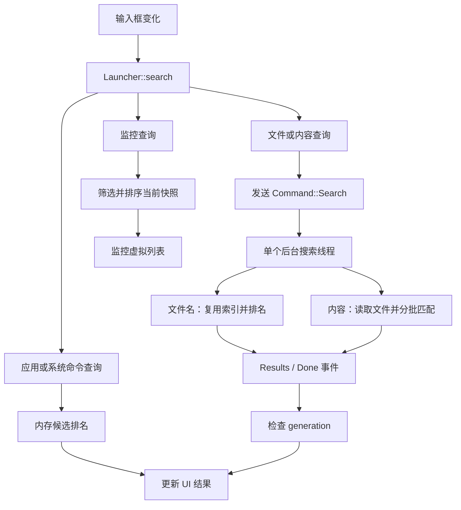

# 从零读懂 Starter 本轮性能优化

撰写日期：2026-10-13。本文讲解 2026-10-12 完成的这一轮性能优化，目标是提高响应速度、减少重复计算和临时分配，并保留有价值的热缓存。

2026-10-14 补记：0.6.0 提交前，纠错代码又调整为仅对 4–31 字符查询启用，并用 `find_map` 在首个容差内匹配时返回。这是本文所述优化之后的行为调整，可能改变部分纠错结果的相对顺序。下文关于最小距离、评分等价的讨论和性能表对应 10 月 12 日的实现；阅读当前 `score_name` 时请以此补记为准。

你可以把它当作一次带着读代码的教程：先认识原来的运行方式，再看开销从哪里产生，最后读新的实现和验证方法。每一项都回答四个问题：**之前怎么做、为什么有开销、现在怎么改、为什么行为还能保持一致。**

本文的“修改前”是本轮优化开始时的工作区代码。当时已经包含你修改的 macOS 全屏窗口策略和系统监控功能，不能直接用已发布的 0.5.0 提交充当所有片段的旧版本。本轮优化涉及监控功能的内部实现，但没有重新实现监控功能，也没有改写你的全屏修复。

下文“代码摘录”来自修改前后的真实源码；为便于阅读，有些片段省略外围函数和不相关分支，不能作为独立程序直接编译。标为“示意”的内容用于解释原理。源码链接指向当前机器上的文件，行号以后可能变化，可以按函数名重新定位。

## 阅读路线与改动地图

建议先读第 1 节，知道一次输入经过哪些模块；然后依次读第 2～8 节的前后对照；最后看第 9～12 节，学习怎么测量、验证和自己实施同类优化。

| 改动位置 | 原来的额外工作 | 新的实现 | 主要收益 |
| --- | --- | --- | --- |
| [应用搜索入口 ui.rs](/Users/mkh/code1/starter/src/ui.rs:571) | 每次输入复制所有应用候选 | 借用应用与内置命令的迭代器 | 减少输入事件中的深拷贝 |
| [内置命令 system_commands.rs](/Users/mkh/code1/starter/src/system_commands.rs:224) | 每次查询重建名称、详情和别名 | `LazyLock` 初始化一次，返回静态切片 | 保留小型热缓存，减少字符串分配 |
| [文件索引 search.rs](/Users/mkh/code1/starter/src/search.rs:363) | 每个文件常驻完整 UI 数据 | 精简的 `FileEntry`，只为结果生成 `Candidate` | 减少重复路径，保留文件名缓存 |
| [排名 search.rs](/Users/mkh/code1/starter/src/search.rs:212) | 保留所有匹配项的打分记录，最后裁剪 | 分批保留全局前 100 名，空查询跳过模糊匹配器 | 控制临时堆峰值 |
| [纠错 search.rs](/Users/mkh/code1/starter/src/search.rs:316) | 重复转换大小写、构造前缀、计算相同距离 | 复用小写名称、借用前缀、跳过重复距离 | 减少 CPU 计算和临时字符串 |
| [搜索线程 worker.rs](/Users/mkh/code1/starter/src/worker.rs:51) | 热文件名查询也固定等待 50 ms；扫描分支重复 | 只对内容搜索等待，合并应用发现流程 | 缩短热查询等待，集中维护刷新逻辑 |
| [任务管理 ui.rs](/Users/mkh/code1/starter/src/ui.rs:408)、[系统操作 launcher_commands.rs](/Users/mkh/code1/starter/src/ui/launcher_commands.rs:195) | 已完成任务的句柄一直追加保存 | 新任务登记前清理已完成句柄 | 避免长期使用时列表持续增长 |
| [监控排序 monitor.rs](/Users/mkh/code1/starter/src/monitor.rs:44)、[监控界面 monitor_panel.rs](/Users/mkh/code1/starter/src/ui/monitor_panel.rs:14) | 虚拟列表绘制前复制所有匹配进程 | `Arc<Snapshot>` 加排序索引 | 共享一份快照，只读取可见行 |
| [基准程序 performance.rs](/Users/mkh/code1/starter/examples/performance.rs:1) | 缺少本轮可重复的搜索测量入口 | 临时数据集、生产搜索函数、计数分配器 | 用同样输入检查收益 |
| [搜索测试](/Users/mkh/code1/starter/src/search.rs:779)、[工作线程测试](/Users/mkh/code1/starter/src/worker.rs:263)、[UI 测试](/Users/mkh/code1/starter/src/ui/tests.rs:242) | 新结构需要额外的回归证据 | 排名等价、文件身份、缓存刷新、任务生命周期测试 | 防止速度提高却改变行为 |
| [性能优化记录](/Users/mkh/code1/starter/docs/优化路线.md) | 旧路线文档中有过时的描述与待办 | 改为实际链路、取舍和测量记录 | 让文档与代码一致 |

本轮没有新增或删除运行依赖，也没有删除源文件。工作区中的依赖与全屏相关改动属于此前已有的工作，不能把整份 `git diff` 都归因于这次优化。

## 1. 先看懂一次输入经过哪些地方

### 1.1 界面入口与后台线程

输入框在 [Launcher::new](/Users/mkh/code1/starter/src/ui.rs:144) 中订阅了输入变化：

```rust
InputEvent::Change => this.search(cx),
```

用户每输入或删除一个字符，就会调用一次 `Launcher::search`。这里根据查询模式选择不同路径：



**应用搜索在 UI 路径中直接计算。文件搜索在后台线程计算。** 这是理解优化位置的第一步：应用列表的一次深拷贝会直接占用处理输入的时间；文件搜索的额外等待则发生在后台，但用户仍要等结果。

后台线程和消息通道原本就存在。这次没有把搜索改成“每次按键新建一个线程”，也没有替换 `async-channel`。工作线程仍然独自拥有文件索引，避免多个线程同时修改索引所需的锁和协调。

### 1.2 一个搜索结果是什么

界面使用 [Candidate](/Users/mkh/code1/starter/src/search.rs:100) 表示候选项：

```rust
#[derive(Clone, Debug)]
pub struct Candidate {
    pub id: String,
    pub title: String,
    pub detail: String,
    pub path: PathBuf,
    pub kind: Kind,
    pub aliases: Vec<String>,
}
```

例如一个文件结果包含：

| 字段 | 示例 | 用途 |
| --- | --- | --- |
| `id` | `/Users/mkh/Documents/项目计划.txt` | 稳定身份、排序兜底 |
| `title` | `项目计划.txt` | 显示名称、搜索匹配 |
| `detail` | `/Users/mkh/Documents` | 界面中的路径说明 |
| `path` | 同一个文件的路径 | 打开或定位文件 |
| `kind` | `Kind::File` | 区分文件、目录等 |
| `aliases` | 文件通常为空 | 应用和命令的其他搜索名称 |

它适合表示“准备显示或执行的结果”。至于 10 万个索引项是否都需要长期保存这样一份完整数据，是第 3 节要解决的问题。

### 1.3 读后面的 Rust 代码，需要认识几个词

| 写法 | 在本文中的意思 |
| --- | --- |
| `Vec<T>` | 一组可增长的数据 |
| `String`、`PathBuf` | 拥有自己的字符串或路径存储 |
| `&T`、`&str`、`&[T]` | 借用现有数据，自己不复制其内容 |
| `.clone()` | 创建一个副本；复制 `String` 与复制 `Arc` 的成本不同 |
| `.iter()` | 按顺序读取已有集合，不复制集合 |
| `.chain(...)` | 把两个读取序列接起来，依次访问 |
| `Cow<'_, str>` | 可以借用字符串，也可以在必要时拥有一个字符串 |
| `Arc<T>` | 多个地方共同拥有同一份数据，最后一个引用释放时才销毁数据 |
| `Task<()>` | GPUI 异步任务的句柄，任务不返回业务数据 |

后面说“删除克隆”，都指具体的一次复制。最终结果仍需要自己的数据，快照仍需要自己的生命周期；这些必要的所有权会保留。

## 2. 应用搜索：从复制整表改成直接借用

### 2.1 修改前：先准备一份独立的候选列表

旧 `Launcher::search` 的应用分支如下：

```rust
let mut candidates = self.candidates.clone();
if !self.query.text.is_empty() {
    candidates.extend(system_commands::candidates());
}
self.results = search::rank_apps(
    &candidates,
    &self.query.text,
    &self.history.entries,
    &self.config.favorites,
);
```

原设计很直接：复制应用列表，把命令追加进去，再交给排名函数。这样不会修改 `self.candidates`，也方便统一搜索应用和命令。

问题在于 `Candidate` 里有多份 `String`、`PathBuf` 和别名列表。`Vec<Candidate>::clone()` 会逐个克隆候选，字符串内容也随之复制。输入 `terminal` 时，可能不是只做一次这种准备，而是每个输入变化都做一次。

排名原本就只读取输入，没有修改它。为了读取两个集合，先复制其中一个，再把另一个追加进去，这段准备工作可以省去。

### 2.2 修改后：让排名函数接收借用迭代器

新入口的代码摘录：

```rust
let commands = if self.query.text.is_empty() {
    &[][..]
} else {
    system_commands::candidates()
};
self.results = search::rank_apps(
    self.candidates.iter().chain(commands),
    &self.query.text,
    &self.history.entries,
    &self.config.favorites,
);
```

可以把 `chain` 理解成：**读完应用候选后，继续读命令候选。** 它不会合成一份新的大数组。

为支持这条路径，[rank_apps](/Users/mkh/code1/starter/src/search.rs:202) 的参数从切片改为借用迭代器：

```rust
pub fn rank_apps<'a>(
    candidates: impl IntoIterator<Item = &'a Candidate>,
    query: &str,
    usage: &BTreeMap<String, Usage>,
    favorites: &BTreeSet<String>,
) -> Vec<Candidate> {
    rank_with_preferences(candidates, query, usage, favorites, &AtomicBool::new(false))
        .unwrap_or_default()
}
```

这里的 `'a` 表示输入引用的有效时间。它约束排名函数在读取期间不能拿到已经失效的候选。函数最后返回 `Vec<Candidate>`，结果拥有自己的数据，不把这些输入引用长期交给 UI。

原来传入 `&Vec<Candidate>` 或 `&[Candidate]` 的调用仍然可以使用，因为它们也能提供 `&Candidate` 的迭代器。无需让每个调用方手工收集一份新列表。

空查询仍然只展示应用；有输入时才把命令加入候选。用户看到的这个规则没有改变。

### 2.3 内置命令也只需要构造一次

原 `system_commands::candidates()` 每次调用都遍历 `COMMANDS`，将静态文字转换成拥有存储的 `Candidate`：

```rust
pub fn candidates() -> Vec<Candidate> {
    COMMANDS
        .iter()
        .map(|command| Candidate {
            id: format!("command:{}", command.id),
            title: command.title.into(),
            detail: command.detail.into(),
            aliases: command.aliases.iter().map(|s| (*s).into()).collect(),
            path: PathBuf::new(),
            // 省略 kind 的映射；它由 command.action 决定。
            kind: match command.action {
                Action::Settings(_) => Kind::SystemSetting,
                Action::Reminders => Kind::ReminderDraft,
                Action::Monitor => Kind::Monitor,
                Action::Power(_) => Kind::SystemCommand,
            },
        })
        .collect()
}
```

这些命令的名称、别名与动作由源码常量定义，一个进程运行期间不会变化。新的 [candidates](/Users/mkh/code1/starter/src/system_commands.rs:224) 把同样的构造放进 `LazyLock`：

```rust
pub fn candidates() -> &'static [Candidate] {
    static CANDIDATES: std::sync::LazyLock<Vec<Candidate>> = std::sync::LazyLock::new(|| {
        COMMANDS
            .iter()
            .map(|command| Candidate {
                id: format!("command:{}", command.id),
                title: command.title.into(),
                detail: command.detail.into(),
                aliases: command.aliases.iter().map(|s| (*s).into()).collect(),
                path: PathBuf::new(),
                kind: match command.action {
                    Action::Settings(_) => Kind::SystemSetting,
                    Action::Reminders => Kind::ReminderDraft,
                    Action::Monitor => Kind::Monitor,
                    Action::Power(_) => Kind::SystemCommand,
                },
            })
            .collect()
    });
    &CANDIDATES
}
```

第一次访问时构造，之后返回同一份数据的切片。`'static` 表示这份借用在进程生命周期内有效。

这是一次明确的缓存取舍：让少量命令文字长期占用内存，换掉每次输入时相同的分配。命令的 `id` 与动作解析规则不变，`/system` 查询也复用这份缓存。

## 3. 文件索引：缓存搜索需要的数据，结果出现后再补齐展示数据

### 3.1 修改前：索引直接保存 Candidate

旧结构：

```rust
#[derive(Default)]
pub struct FileIndex {
    pub candidates: Vec<Candidate>,
    pub skipped: usize,
    pub truncated: bool,
}
```

每发现一个文件或目录，就构造完整的候选：

```rust
index.candidates.push(Candidate {
    id: entry.path().display().to_string(),
    title: entry.file_name().to_string_lossy().into_owned(),
    detail: entry.path().parent().unwrap_or(root).display().to_string(),
    path: entry.path().to_path_buf(),
    kind: if kind.is_dir() { Kind::Folder } else { Kind::File },
    aliases: Vec::new(),
});
```

它的好处是复用现成的排名和界面结构。搜索返回时直接克隆候选即可。

但同一个文件的完整路径同时出现在 `id` 和 `path` 中；父目录又保存在 `detail` 中。索引最多 100,000 项，长路径重复保存的开销随索引规模增加，而每次查询最多展示 100 条结果。

### 3.2 修改后：索引用 FileEntry，UI 仍用 Candidate

新的结构：

```rust
#[derive(Default)]
pub struct FileIndex {
    files: Vec<FileEntry>,
    pub skipped: usize,
    pub truncated: bool,
}

struct FileEntry {
    path: PathBuf,
    name: String,
    lower: String,
    kind: Kind,
}
```

扫描时保存：

```rust
let name = entry.file_name().to_string_lossy().into_owned();
index.files.push(FileEntry {
    path: entry.path().to_path_buf(),
    lower: name.to_lowercase(),
    name,
    kind: if kind.is_dir() { Kind::Folder } else { Kind::File },
});
```

这里没有追求“只留一个路径，其他一律现场计算”。`name` 与 `lower` 都保留了：

- `name` 用于显示和模糊匹配，避免每次输入反复从路径中解析文件名。
- `lower` 用于忽略大小写的比较和排序，避免每个查询都给所有文件名转换大小写。
- `path` 保留完整身份和打开位置；`kind` 保留文件与目录的区别。

本轮曾比较过只保留路径的方案，实际查询变慢，所以最终选择保留短文件名缓存。这符合你的要求：允许有用的常驻内存，优先保障响应速度。

### 3.3 为什么没有写两套排名函数

应用候选还是 `Candidate`，文件索引现在是 `FileEntry`。它们的数据结构不同，但排名需要的操作相同：读取名称、读取身份、取得别名、把胜出的项转换成结果。

新的私有 [SearchEntry](/Users/mkh/code1/starter/src/search.rs:380) 表达这些操作：

```rust
trait SearchEntry {
    fn title(&self) -> Cow<'_, str>;
    fn lower_title(&self) -> Cow<'_, str> {
        Cow::Owned(self.title().to_lowercase())
    }
    fn id(&self) -> Cow<'_, str>;
    fn aliases(&self) -> &[String] {
        &[]
    }
    fn candidate(&self) -> Candidate;
}
```

`Candidate` 的实现借用已有名称与 ID，返回已有别名，最后克隆自身。它没有新增一份应用名称的小写缓存，仍使用默认 `lower_title` 在查询中计算。

`FileEntry` 则直接借用索引中的小写缓存：

```rust
impl SearchEntry for FileEntry {
    fn title(&self) -> Cow<'_, str> {
        Cow::Borrowed(&self.name)
    }
    fn lower_title(&self) -> Cow<'_, str> {
        Cow::Borrowed(&self.lower)
    }
    fn id(&self) -> Cow<'_, str> {
        self.path.to_string_lossy()
    }
    fn candidate(&self) -> Candidate {
        Candidate {
            id: self.id().into_owned(),
            title: self.title().into_owned(),
            detail: self
                .path
                .parent()
                .unwrap_or(&self.path)
                .display()
                .to_string(),
            path: self.path.clone(),
            kind: self.kind,
            aliases: Vec::new(),
        }
    }
}
```

在 macOS 上，常规 UTF-8 路径的 `to_string_lossy()` 可以借用路径文本；遇到无法直接表示的路径时会构造替代文本。Windows 的路径转换有不同的内部存储条件，不能假定总能借用。使用 `Cow` 保留了原来的路径显示处理方式，同时让可借用的情况避免额外分配。

`candidate()` 只在排名结束、确认最终结果后调用。于是流程从“先把所有文件变成 UI 候选，再选结果”，变成了：

```text
扫描 → FileEntry 热索引 → 统一排名 → 最多 100 个胜出项 → Candidate → UI
```

这里确实保留了两种结构，但没有维护两份同步的常驻索引。`FileEntry` 负责搜索所需的长期数据，`Candidate` 负责最终结果；转换发生在一个明确的位置。`SearchEntry` 是模块内部的两种输入之间的接口，没有增加插件注册或动态分发系统。

### 3.4 新索引提供自己的查询入口

[FileIndex::search](/Users/mkh/code1/starter/src/search.rs:443) 隐藏内部存储结构：

```rust
pub fn search(&self, query: &str, cancelled: &AtomicBool) -> Option<Vec<Candidate>> {
    rank_with_preferences(
        &self.files,
        query,
        &BTreeMap::new(),
        &BTreeSet::new(),
        cancelled,
    )
}
```

文件查询原本就没有应用的收藏和使用频率，所以这里传空集合，行为不变。工作线程现在调用 `index.search(...)`，统计数量则调用 `index.len()`，不用知道索引项如何保存。

旧的 `rank_cancellable` 只是将参数转交给同一排名逻辑。它的唯一生产调用迁到这里后，这个旧入口被删除；取消参数和取消行为仍然保留。

## 4. 排名：每一项仍然打分，但无需留下所有打分记录

### 4.1 修改前已经使用了部分选择

旧排名函数先建立 `scored` 列表，保存每一个匹配项的记录。记录包括相关性分数、收藏状态、使用次数、最近打开时间、小写名称和候选引用：

```rust
let mut scored = Vec::new();
// 在遍历每个匹配候选时执行：
scored.push((
    score,
    favorites.contains(&candidate.id),
    usage.count,
    usage.last_opened,
    candidate.title.to_lowercase(),
    candidate,
));
```

所有候选检查完后，再裁剪：

```rust
if scored.len() > RESULT_LIMIT {
    scored.select_nth_unstable_by(RESULT_LIMIT, compare);
    scored.truncate(RESULT_LIMIT);
}
scored.sort_unstable_by(compare);
```

这段代码原本就没有对所有匹配项做完整排序。`select_nth_unstable_by` 先划分出排名靠前的部分，再只排序最终结果。

本轮要解决的是**裁剪之前的数据峰值**：例如空查询命中接近 10 万项，`scored` 就要先留下接近 10 万份记录，其中还包含新分配的小写名称。最终只显示 100 项，前面的大量记录只在这次查询中短暂存在。

### 4.2 修改后：每批裁剪，最终再排好顺序

新的常量与打分记录：

```rust
pub const RESULT_LIMIT: usize = 100;
const RANK_BATCH: usize = 4096;

type Scored<'a, T> = (u32, bool, u64, u64, Cow<'a, str>, Cow<'a, str>, &'a T);
```

记录中的两个 `Cow` 分别是小写名称与 ID。文件的小写名称可以直接借用缓存，ID 通常可以借用路径文本，比较器不必反复从路径中提取它们。

每次追加一个命中项后检查批次大小：

```rust
if scored.len() == RANK_BATCH {
    scored.select_nth_unstable_by(RESULT_LIMIT, compare);
    scored.truncate(RESULT_LIMIT);
}
```

到达 4096 项时，只保留这批数据里最好的 100 项。然后继续检查后面的候选，把新命中项追加到这 100 项后面，达到阈值时再次裁剪。

遍历结束后，仍然执行最终选择与排序：

```rust
if scored.len() > RESULT_LIMIT {
    scored.select_nth_unstable_by(RESULT_LIMIT, compare);
    scored.truncate(RESULT_LIMIT);
}
scored.sort_unstable_by(compare);
Some(
    scored
        .into_iter()
        .map(|(_, _, _, _, _, _, c)| c.candidate())
        .collect(),
)
```

`truncate` 会销毁丢弃记录中的自有字符串；向量容量可以继续复用。这一改动限制的是临时打分列表，而不是文件索引本身，也不是只扫描前 4096 个文件。**每个候选仍然有机会参与打分。**

### 4.3 为什么丢弃一部分项不会丢掉全局前 100 名

先用“只保留前 3 名”的简化示意理解：

```text
第一批分数：90、80、70、60、50
保留：90、80、70

下一批带来：95、85、10
合并后选前三：95、90、85
```

第一批被丢弃的 60 分，已经有 90、80、70 三项排在前面。后面加入再多候选，也不会让它超过这些既有项，因此它不可能重新进入全局前三。

前 100 名同理：某项在已经处理的集合中排不到前 100，就已有至少 100 个更靠前的项。只要后续一直使用同一套比较规则，这个淘汰就是安全的。

实际比较规则没有改变：

```rust
let compare = |a: &Scored<'_, T>, b: &Scored<'_, T>| {
    b.0.cmp(&a.0)
        .then_with(|| b.1.cmp(&a.1))
        .then_with(|| b.2.cmp(&a.2))
        .then_with(|| b.3.cmp(&a.3))
        .then_with(|| a.4.cmp(&b.4))
        .then_with(|| a.5.cmp(&b.5))
};
```

按顺序读取这段代码：相关性高的在前，然后是收藏、使用次数、最近使用；仍相同则按小写名称与 ID 升序。`then_with` 表示前一个条件相等时，才比较下一个条件。

这套规则保证相同标题但不同身份的候选有确定顺序。收藏不会突破相关性优先的规则；它在空查询或同分时发挥作用。新测试会检查跨多个批次的结果与全量排序前 100 项一致。

### 4.4 空查询只需要排序，不需要模糊匹配工作区

旧代码即使查询为空，也先创建 `Matcher`，然后在 `score_name` 中返回 0 分。新代码把这个选择提前：

```rust
let mut matcher = (!query.is_empty()).then(|| Matcher::new(MatcherConfig::DEFAULT));
```

非空查询才构造匹配器；空查询直接给候选 0 分，再按收藏、频率等规则排名。

`Pattern::new(...)` 仍在函数前面构造；这次跳过的是 `Matcher` 及其模糊匹配工作区和名称匹配流程。不要把这项优化理解成空查询完全不分配内存：结果、排序记录，以及应用的小写名称仍可能分配。

## 5. 拼写纠错：保持算法，减少同一件事做两遍

### 5.1 原来的评分顺序

`score_name` 原本就有四级规则，本轮保留：

| 匹配方式 | 示例 | 分数所在层级 |
| --- | --- | --- |
| 完全相同 | `Terminal` 与 `terminal` | 300,000 |
| 前缀匹配 | `Terminal` 与 `term` | 接近 200,000 |
| 模糊匹配 | 字符按顺序出现 | 100,000 以上 |
| 拼写纠错补救 | `Terminal` 与 `termianl` | 10,000 或 9,000 等 |

纠错只在前三种没有匹配成功后执行。查询长度为 3～64 个字符时，使用 Damerau–Levenshtein 距离，长度至少 7 时容忍 2 步，否则容忍 1 步。该距离可以处理字符的插入、删除、替换和相邻交换。

所以“无命中”也可能很贵：系统需要对大量候选尝试纠错，才能确认没有结果。最终显示零项，并不意味着前面没做计算。

### 5.2 复用已经得到的小写名称

原函数自己执行 `name.to_lowercase()`；命中后，排名又执行一次 `candidate.title.to_lowercase()` 作为排序键。

现在排名先拿到 `lower`，传给 `score_name` 使用，命中时也将同一份值作为排序键。文件的 `lower` 直接来自索引缓存。应用和别名仍可能在本次查询中计算小写文本；这次没有引入全局的应用别名归一化缓存。

### 5.3 不必为前缀创建一个新 String

旧纠错代码摘录：

```rust
let prefix: String = word.chars().take(length).collect();
let prefix_distance = strsim::damerau_levenshtein(query, &prefix);
if word.chars().count().abs_diff(length) <= tolerance {
    prefix_distance.min(strsim::damerau_levenshtein(query, word))
} else {
    prefix_distance
}
```

新代码先找到字符边界，再借用原字符串的前缀：

```rust
let end = word
    .char_indices()
    .nth(length)
    .map_or(word.len(), |(index, _)| index);
let prefix = &word[..end];
let prefix_distance = strsim::damerau_levenshtein(query, prefix);
if prefix != word && word.chars().count().abs_diff(length) <= tolerance {
    prefix_distance.min(strsim::damerau_levenshtein(query, word))
} else {
    prefix_distance
}
```

为什么不直接写 `&word[..length]`？Rust 的字符串以 UTF-8 存储，字节数不等于字符数。中文字符通常占多个字节，直接用字符个数当字节下标可能截在字符中间。

`char_indices().nth(length)` 得到第 `length + 1` 个字符开始的字节位置，用它截取前 `length` 个字符；如果没有那么多字符，就使用整个字符串长度。这和旧 `chars().take(length)` 的取值一致，却不需要另建前缀字符串。

### 5.4 相同的距离不用计算两次

如果 `word` 比查询短或等长，取出的前缀就是整个 `word`。旧代码在长度条件允许时会对同样的两个字符串再算一次距离。新代码中的 `prefix != word` 跳过这次重复调用，直接复用 `prefix_distance`。

此外，旧代码把完整名称放在序列开头，又追加按分隔符切出的词。当名称本身就是一个完整单词时，会出现同一段文本两遍。新代码过滤掉这种重复：

```rust
std::iter::once(lower)
    .chain(
        lower
            .split(|c: char| !c.is_alphanumeric())
            .filter(|word| *word != lower),
    )
```

这些更改没有替换距离算法、放宽容错规则或跳过本来唯一的比较。完整 Damerau–Levenshtein 运算仍有开销，基准里纠错和长无命中查询仍明显比普通匹配慢。

## 6. 工作线程：让热查询立即开始，合并重复发现流程

### 6.1 原来所有磁盘查询都等待 50 ms

旧 `Command::Search` 在确认没有取消后，无条件执行：

```rust
if cancelled.load(Ordering::Relaxed) {
    continue;
}
thread::sleep(Duration::from_millis(50));
if cancelled.load(Ordering::Relaxed) {
    continue;
}
```

它的意图是去抖：连续输入时，让过期查询在真正工作前被取消，少做一些磁盘扫描。

内容搜索每次查询都要读取文件，这个等待有实际作用。但文件名搜索在索引建立后，查询主要是在内存中排名；即使缓存已热，也要固定等 50 ms。

### 6.2 现在只有内容搜索继续等待

新实现：

```rust
if cancelled.load(Ordering::Relaxed) {
    continue;
}
if query.mode == Mode::Content {
    thread::sleep(Duration::from_millis(50));
}
if cancelled.load(Ordering::Relaxed) {
    continue;
}
```

文件名查询在工作线程取到命令后直接开始处理；如果索引已有，就直接排名。**首次查询仍需建索引**，这次没有新增启动时全盘扫描。

去掉等待后，快速输入可能让某些很快被取代的文件查询提前开始计算。因此取消检查仍然必要：工作线程进入查询前检查一次，索引遍历和排名循环中继续检查，发送结果前再检查。这里用较快响应换掉统一等待，而没有承诺每一次旧请求都完全零工作。

### 6.3 应用扫描和完整刷新共用发现代码

修改前 `Apps` 与 `Refresh` 是两段分支：两边都调用 `catalog::discover()`、`uninstall::discover()`，再发送相同的 `Event::Apps`；只有 `Refresh` 先清空文件索引。

新分支把相同流程合在一起：

```rust
command @ (Command::Apps { generation } | Command::Refresh { generation }) => {
    if matches!(command, Command::Refresh { .. }) {
        cached_roots = None;
        index = FileIndex::default();
    }
    let catalog = catalog::discover();
    let uninstall_targets = uninstall::discover(&catalog);
    if events
        .send_blocking(Event::Apps {
            generation,
            catalog,
            uninstall_targets,
        })
        .is_err()
    {
        break;
    }
}
```

`|` 表示匹配两种命令，`command @ ...` 同时保留整条命令，方便判断是不是 `Refresh`。

两个命令本身没有被合成一种，因为它们代表不同的用户意图：

| 输入 | 文件索引怎么处理 |
| --- | --- |
| 展示窗口时扫描应用，即 `Apps` | 保留已有热索引 |
| 用户明确刷新，即 `Refresh` | 丢弃索引，下一次文件查询重建 |
| 查询使用的搜索根目录改变 | 按新根目录重建 |
| 根目录相同，继续文件查询 | 复用索引 |

这套缓存失效规则在本轮之前就存在，合并分支时保留了它。没有新增文件监听器，索引建立后新增的文件也不会仅因又输入一次查询就自动出现；需要明确刷新或改变搜索目录。缓存收益与这个原有取舍一起保留。

### 6.4 取消标记与 generation 各解决一个问题

`Launcher::search` 原有的查询准备继续保留：

```rust
self.cancelled.store(true, Ordering::Relaxed);
self.cancelled = Arc::new(AtomicBool::new(false));
self.generation += 1;
```

旧查询的取消标记被设为 `true`，新查询取得一枚新的标记。`Arc` 让 UI 和后台查询能访问同一枚标记。

`generation` 是查询编号。结果事件回到 UI 时，只有编号等于当前查询编号才会被接收：

```rust
worker::Event::Results {
    generation,
    candidates,
} if generation == self.generation => {
    self.results.extend(candidates);
    cx.notify();
}
```

取消标记减少过期计算，查询编号避免过期结果显示。即使结果已经进了队列、来不及被取消，新查询的界面也不会被它覆盖。

应用扫描使用独立的 `catalog_generation`。应用发现结果不应随意取消正在进行的文件查询，这个原有边界也保留。工作线程仍使用容量为 8 的命令通道和容量为 32 的事件通道，没有本轮新增的无限查询队列。

## 7. 异步任务：保存活跃任务，清理已经完成的句柄

### 7.1 为什么原来要把 Task 放进列表

界面里一些操作不能立即结束，例如等待失焦宽限、查询更新、下载更新、执行卸载、打开应用组、执行系统操作。它们使用 `cx.spawn_in(...)` 创建异步任务。

GPUI 的 `Task` 具有一个重要语义：**丢弃尚未完成的句柄会取消相应任务；`detach()` 则允许任务在没有这个句柄的情况下继续运行。**

因此原代码将句柄留在 `Launcher::_tasks` 中：

```rust
self._tasks.push(cx.spawn_in(window, async move |this, cx| {
    // 等待后台操作，然后把结果更新到 Launcher。
}));
```

这段是原调用形态的示意，具体任务体各不相同。保存句柄有明确目的：让任务正常完成，并使句柄与界面对象的生命周期一起结束。窗口与实体销毁时，仍被持有的任务句柄随之释放。

但任务已经完成之后，旧代码没有从列表移除句柄。反复打开、隐藏窗口和执行操作，列表会持续追加。

这不等于所有已完成任务还在运行，也不能说它们都保留着原任务体的全部数据。准确的问题是：**完成后的句柄仍占据列表和任务管理存储。**

### 7.2 新增一个负责生命周期的登记入口

新的 [track_task](/Users/mkh/code1/starter/src/ui.rs:408)：

```rust
fn track_task(&mut self, task: Task<()>) {
    self._tasks.retain(|task| !task.is_ready());
    self._tasks.push(task);
}
```

可以逐行读：

1. `retain` 保留条件为真的项。
2. `is_ready()` 检查任务是否已经完成；对当前 GPUI 的已调度任务，它对应底层的 `is_finished()`。
3. `!task.is_ready()` 让活跃任务继续留在列表里。
4. 最后登记新任务。

完成任务的清理发生在**下一次登记任务时**，没有另设一个定时清理线程。最近一次完成的任务可能暂时留下句柄，但连续操作不会一直积累已完成句柄。正在运行的任务可以有多个，这个函数没有把并发任务强制压成一个。

`Vec` 的容量也不必每次清理后缩小；删除元素释放的是对应句柄，保留容量可以供下次登记使用。

### 7.3 哪些调用换成了这个入口

动态创建的 Launcher 任务统一改走 `track_task`，包括失焦延时、更新检查、更新安装事件处理、卸载完成处理、应用组打开，以及 [系统电源操作](/Users/mkh/code1/starter/src/ui/launcher_commands.rs:181)。每天检查更新的循环任务也通过这里登记，它在运行期间继续保留。

失焦任务的新调用摘录：

```rust
self.track_task(cx.spawn_in(window, async move |this, cx| {
    cx.background_executor().timer(ACTIVATION_LOSS_GRACE).await;
    let _ = this.update_in(cx, |this, window, cx| {
        if this.activation_generation == generation
            && this
                .should_hide_on_activation_loss(window.is_window_active(), can_dismiss)
        {
            this.hide(window, cx);
        }
    });
}));
```

实际任务体中的 150 ms 宽限、激活代数检查和再次确认窗口状态都保留。本轮只改登记方式，没有借此重写你的全屏行为。

启动时创建的长期事件接收任务仍然被持有，因为它们要持续等待搜索、图标、剪贴板等事件。设置页中的文件选择任务属于另一个实体 `Settings`，本轮没有为了统一名称而扩大到它们。

这里没有把所有任务换成 `detach()`：那会失去原有的句柄取消关系。`track_task` 也不是一个纯粹转发的包装，它集中负责“保留活跃任务、移除完成任务”的策略。

## 8. 监控列表：共享不可变快照，把排序结果变成索引

### 8.1 原来已经有虚拟列表，但绘制前仍复制整表

监控线程产生 `Snapshot`，其中 `processes` 是一组 `ProcessUsage`。每一行包括应用身份、名称、可执行路径、进程数量、CPU 和内存用量。

旧 UI 保存：

```rust
monitor_snapshot: Option<monitor::Snapshot>,
```

排序函数返回的是行引用：

```rust
pub fn ranked(&self, query: &str, sort: Sort) -> Vec<&ProcessUsage>
```

随后监控界面这样准备虚拟列表：

```rust
let ranked: Vec<_> = ranked.into_iter().cloned().collect();
uniform_list(
    "monitor-rows",
    ranked.len(),
    cx.processor(move |this, range: std::ops::Range<usize>, _, cx| {
        range
            .map(|index| this.monitor_row(&ranked[index], memory_total, cx))
            .collect::<Vec<_>>()
    }),
)
```

`uniform_list` 原本就只为可见范围绘制行。但它的回调要在后面执行，旧实现通过克隆每一条匹配进程的数据，让回调拥有独立数据。

所以虚拟列表减少了绘制工作，却没有消除进入回调之前的深拷贝。只看到十几行，也可能先复制数百行里的名称、ID 和路径。

### 8.2 新 UI 共同拥有一份 Snapshot

现在保存：

```rust
monitor_snapshot: Option<Arc<monitor::Snapshot>>,
```

收到线程的新快照时：

```rust
this.monitor_snapshot = Some(Arc::new(snapshot));
```

`Arc::new` 将已经收到的快照移动到共享存储，不逐行复制它。后续 `Arc::clone` 增加引用计数，让多个地方指向同一份快照。

这和 `Snapshot::clone()` 很不一样：后者会复制其中的进程向量和字段；前者的成本不随进程数量线性增加。新的快照到了，UI 替换自己的 `Arc`；旧绘制回调若还持有旧 `Arc`，它仍能安全读取旧帧数据。

### 8.3 排序只返回行的位置

新的 [Snapshot::ranked](/Users/mkh/code1/starter/src/monitor.rs:44) 返回 `Vec<usize>`：

```rust
pub fn ranked(&self, query: &str, sort: Sort) -> Vec<usize> {
    let query = query.trim().to_lowercase();
    let mut rows: Vec<_> = self
        .processes
        .iter()
        .enumerate()
        .filter(|(_, row)| query.is_empty() || row.name.to_lowercase().contains(&query))
        .map(|(index, _)| index)
        .collect();
    rows.sort_unstable_by(|&a, &b| {
        let a = &self.processes[a];
        let b = &self.processes[b];
        match sort {
            Sort::Cpu => b
                .cpu_percent
                .total_cmp(&a.cpu_percent)
                .then_with(|| b.memory.cmp(&a.memory)),
            Sort::Memory => b
                .memory
                .cmp(&a.memory)
                .then_with(|| b.cpu_percent.total_cmp(&a.cpu_percent)),
        }
        .then_with(|| a.id.cmp(&b.id))
    });
    rows
}
```

例如 `processes` 里有三行，排序返回 `[2, 0, 1]`，意思是显示第 2 行、第 0 行、第 1 行。进程数据的位置没有变，改变的是显示次序。

旧函数空查询时也会给每行名称转小写。新 `.filter(...)` 用短路判断：空查询直接通过，名称转换只在非空筛选时执行。

CPU 排序、内存排序以及 ID 兜底规则保留。原来的稳定排序换成 `sort_unstable_by`，因为生产快照已按 ID 聚合，每行 ID 唯一；完整比较规则不会依赖同一 ID 多行的原始顺序。

### 8.4 绘制回调捕获快照与索引

新的 [monitor_screen](/Users/mkh/code1/starter/src/ui/monitor_panel.rs:14) 摘录：

```rust
let memory_total = snapshot.memory_total;
let snapshot = snapshot.clone();
uniform_list(
    "monitor-rows",
    ranked.len(),
    cx.processor(move |this, range: std::ops::Range<usize>, _, cx| {
        range
            .map(|index| {
                this.monitor_row(
                    &snapshot.processes[ranked[index]],
                    memory_total,
                    cx,
                )
            })
            .collect::<Vec<_>>()
    }),
)
```

这里 `snapshot` 原本就是 `Arc<Snapshot>` 的引用，所以 `.clone()` 复制的是 `Arc`，并没有调用快照的深拷贝。

回调里有两个不同的下标：`index` 是“显示列表第几行”，`ranked[index]` 是“这一行在快照数据里的位置”。把它们串起来，才能读到正确的进程。

**排序索引和生成它的快照必须一起被捕获。** 不能把旧索引拿去查询新一秒的快照，因为新快照可能新增、删除或重排进程，旧位置会指向错误行，甚至越界。捕获该帧的 `Arc`，就同时解决了生命周期和对应关系。

新设计的流程：


排序和筛选仍会遍历数据，并不是整个监控渲染都变成了常数时间。消除的是“为回调拥有数据而复制整张匹配表”的步骤。

### 8.5 原来按需采样的策略继续保留

监控线程原本就只在启用时采样，未启用时阻塞等待命令。启用后每秒更新 CPU、内存和进程；磁盘刷新使用更长的间隔。快照通道容量为 2，队列满时放弃这次新样本。

本轮没有改它的采样频率、CPU 口径、应用聚合身份或数据通道；也没有把每个进程增加一套永久名称缓存。优化集中在当前快照的排序、所有权和界面读取方式。

## 9. 性能基准：把“感觉更快”变成可复测的数值

### 9.1 本轮新增了什么测量入口

新增 [examples/performance.rs](/Users/mkh/code1/starter/examples/performance.rs:1)，用真实生产搜索代码测量应用查询和文件查询，没有另写一套专门用于跑分的排名函数。

运行小规模数据：

```sh
cargo run --release --locked --example performance -- 10000
```

运行接近索引上限的数据：

```sh
cargo run --release --locked --example performance -- 98000
```

如果依赖已在本机，可以加 `--offline`，本轮实际验证使用了这个选项。

程序构造 500 个应用候选，包含英文名称与中文别名。文件部分使用 `tempfile::tempdir()` 创建临时目录，每组创建两级目录与最多 100 个空文件，文件名混合英文报告与中文报告。98,000 个文件加上 1,960 个目录，共 99,960 条索引。

它只处理自己构造的数据，不扫描用户的文档；正常结束时临时目录自动清理。临时文件创建和索引构建在查询计时之外，所以报告的是**热索引上的排名计算**，不包含磁盘扫描建索引的时间。

### 9.2 三个堆计数各是什么意思

程序用一个包装 `System` 分配器的计数器观察 Rust 分配：

```rust
static LIVE: AtomicUsize = AtomicUsize::new(0);
static PEAK: AtomicUsize = AtomicUsize::new(0);
static ALLOCATED: AtomicUsize = AtomicUsize::new(0);

#[global_allocator]
static HEAP: Heap = Heap;
```

分配时增加当前存活字节数，释放时减少，重新分配成功时用新旧大小更新计数。实际申请和释放仍交给 `System`。

下面是分配和释放方法的代码摘录，它们位于 `unsafe impl GlobalAlloc for Heap` 中：

```rust
unsafe fn alloc(&self, layout: Layout) -> *mut u8 {
    let pointer = unsafe { System.alloc(layout) };
    if !pointer.is_null() {
        let live = LIVE.fetch_add(layout.size(), Relaxed) + layout.size();
        PEAK.fetch_max(live, Relaxed);
        ALLOCATED.fetch_add(layout.size(), Relaxed);
    }
    pointer
}

unsafe fn dealloc(&self, pointer: *mut u8, layout: Layout) {
    LIVE.fetch_sub(layout.size(), Relaxed);
    unsafe { System.dealloc(pointer, layout) };
}
```

`layout.size()` 是申请的字节数，`fetch_add`/`fetch_sub` 更新计数，`fetch_max` 保留遇到过的最高值。只有申请成功才加计数；`realloc` 同样先确认成功，再减掉旧大小、增加新大小。`unsafe` 来自分配器接口对指针和布局的要求，这个包装没有自己实现内存池或改变系统分配器的布局与对齐规则。

| 指标 | 含义 | 不能据此断言什么 |
| --- | --- | --- |
| `LIVE` | 计数器观察到的当前存活 Rust 分配字节 | 整个进程此时的 RSS |
| `PEAK` | 测量期间观察到的最高存活字节数 | 操作系统的完整物理内存峰值 |
| `ALLOCATED` | 测量期间累计申请的字节；重分配按新块大小记入 | 这些字节同时常驻内存 |

例如一次查询申请并释放 100 MiB 临时数据，即使峰值只有 1 MiB，累计分配仍可能接近 100 MiB。降低累计分配能减少分配器工作，但它和常驻内存不是同一个指标。

索引的常驻堆在索引构建前后读取 `LIVE` 差值；临时去重集合在构建返回后已经释放，因此这个差值主要反映保留下来的索引。它是这组路径长度和文件名下的结果，换成很短或很长的真实路径，数值会变化。

### 9.3 每轮查询怎么计时

[measure](/Users/mkh/code1/starter/examples/performance.rs:55) 的主要逻辑：

```rust
black_box(search());
let live = LIVE.load(Relaxed);
PEAK.store(live, Relaxed);
ALLOCATED.store(0, Relaxed);
let start = Instant::now();
for _ in 0..rounds {
    black_box(search());
}
let elapsed = start.elapsed();
let allocated = ALLOCATED.load(Relaxed);
let peak = PEAK.load(Relaxed).saturating_sub(live);
```

先查询一次预热，再清零本轮累计计数并重复查询。`black_box` 让编译器不能简单把“结果没被使用”的计算消掉；每轮结果在使用后释放。应用每个查询重复 30 次，文件每个查询重复 3 次，最后报告平均每次时间、累计分配和额外堆峰值。

这套计数器自己也有原子操作开销，所以比较时使用了同一台 Mac、同样的 release 配置和计数分配器。它适合前后比较，但不能直接等同于没有计数器的完整应用体验。

### 9.4 本轮实际结果

以下是 2026-10-12 的一次前后对照。耗时数值是各场景重复查询的平均值，不是多次独立实验的置信区间。

| 场景 | 修改前 | 修改后 | 如何理解 |
| --- | ---: | ---: | --- |
| 文件索引保留 Rust 堆 | 47.23 MiB | 25.56 MiB | 删除重复路径，保留文件名热缓存 |
| 空文件查询计算 | 3.643 ms | 3.700 ms | 本次未显示计算时间改善，仍需遍历并选择默认结果 |
| 普通文件查询 `report` | 13.931 ms | 10.690 ms | 减少名称处理与临时排名存储 |
| 拼写纠错 `rpeort` | 121.421 ms | 92.643 ms | 同一纠错规则下减少重复工作 |
| 中文文件查询 `项目` | 3.669 ms | 1.599 ms | 名称缓存与借用减少重复分配 |
| 无命中 `zzzzzzzz` | 133.259 ms | 80.640 ms | 仍需尝试纠错，但重复工作减少 |
| `report` 额外堆峰值 | 9,709.9 KiB | 495.1 KiB | 分批裁剪限制打分列表峰值 |
| 500 应用默认列表计算 | 0.140 ms | 0.065 ms | 省去整表克隆，空查询跳过 Matcher |
| 500 应用默认查询累计分配 | 357.3 KiB | 76.9 KiB | 每次输入的临时分配减少 |

工作线程原来固定等待的 50 ms 不在这些搜索计算时间里。文件名查询现在取消了这段等待，因此这项响应改善要单独说明，不能将基准表直接称为“用户输入到显示的总耗时”。

也不要把 25.56 MiB 当作 Starter 的启动占用：文件索引直到第一次文件查询才建立，且这些计数不覆盖 GPU、系统框架的全部分配、线程栈或分配器保留的物理页面。完整应用的启动/驻留 RSS、真实输入到绘制的延迟，以及 Windows 上的运行效果，本轮尚未实测。

监控共享快照与任务句柄回收没有单独的毫秒或内存对照数据。可以从真实调用与测试确认复制路径、累积路径被删除，但不能为它们套用搜索基准的提升百分比。

## 10. 测试：速度提高后，怎么知道原功能还在

### 10.1 跨批次的全局排名

新增 [bounded_ranking_keeps_the_global_top_results_and_identity_ties](/Users/mkh/code1/starter/src/search.rs:779)：构造 12,500 个候选，跨越多个 4096 项批次，加入相同标题、不同 ID、收藏与使用记录。

测试先按原有规则完整排序得到预期前 100 项，再比较新排名的结果。空查询和 `tool` 查询都检查。

它保护的是“分批淘汰不能改变最终顺序”，而不是断言某个内部函数被调用了几次。这里各名称归一化后相同，因此预期比较器能专注于收藏、使用与身份的同分顺序；普通相关性和纠错层级继续由原有搜索测试保护。

### 10.2 文件身份、显示字段和取消

新增 [file_hits_preserve_paths_types_and_duplicate_root_handling](/Users/mkh/code1/starter/src/search.rs:826)：临时创建中文目录与文件，同时用父目录和子目录作为根，检查重复根不会导致重复结果。

它检查新索引转成结果后仍有正确的 ID、名称、父目录、路径，以及文件/目录类型，最后设置取消标记，确认文件查询返回 `None`。

原有文字内容、二进制排除、忽略规则和中文搜索测试继续保留。旧拼写测试里直接调用 `rank_cancellable` 的预取消断言随旧入口删除；取消行为由新文件查询入口的测试继续覆盖。旧测试函数本身没有因为这个断言而整段删除。

### 10.3 用真实工作线程验证缓存失效

新增 [app_scans_keep_filename_cache_and_explicit_refresh_rebuilds_it](/Users/mkh/code1/starter/src/worker.rs:263)，按真实命令通道走如下过程：

```text
写入 alpha.txt → 第一次文件查询建索引 → 得到 1 项
写入 beta.txt → 发送 Apps → 再查询仍为 1 项
发送 Refresh → 再查询重建索引 → 得到 2 项
改用另一个根目录 → 再查询 → 只得到新根目录的文件
```

第二步查询仍为 1 项是有意检查缓存被保留，不能当成测试错误。完整刷新和根目录变化负责让数据重新被扫描。

### 10.4 连续完成的操作不能留下越来越多句柄

新增 [repeated_completed_operations_do_not_accumulate_task_handles](/Users/mkh/code1/starter/src/ui/tests.rs:242)：在真实 GPUI 测试上下文中连续调度 100 个任务，每次运行到任务完成。

```rust
cx.run_until_parked();
launcher.read_with(cx, |this, _| {
    assert_eq!(this.status, operation.to_string());
    assert_eq!(this._tasks.len(), 1);
});
```

状态文本确认任务真的执行并更新了实体，列表长度确认下一次登记释放了旧完成句柄。测试夹具没有生产环境那组长期接收任务，所以这里期望为 1；不能据此推断真实 Launcher 永远只有一个任务。

监控原有排序测试改为“先拿行索引，再读取快照的那一行”，保留 CPU、内存、筛选和无命中的行为断言。监控启停、UI 模式切换、更新、卸载、中文输入等已有测试也继续运行。

### 10.5 本轮验证与后续复测

本轮实现验证在 macOS 上通过：54 个库测试、29 个应用测试，共 83 个；例子目标也能编译。格式检查、Clippy 严格警告检查和 Git 差异空白检查通过。

相应命令：

```sh
cargo fmt --check
cargo clippy --offline --locked --all-targets -- -D warnings
cargo test --offline --locked --all-targets
git diff --check
```

完整测试涉及 macOS 剪贴板、废纸篓、DMG 与本机 HTTP 接口，受限沙盒中可能阻断系统访问，本轮完整测试在沙盒外完成。上述 83 项是实现完成时的记录，本文的文档编写没有改变实现，也没有为纯文档改动重新进行一遍系统测试。

## 11. 把一次新查询从头到尾串起来

假设应用已经启动，用户第一次输入 `/f report`，然后继续输入 `/f rpeort`。

1. **输入事件到来。** `InputEvent::Change` 调用 `Launcher::search`，解析出 `Mode::Files` 和查询文本。
2. **旧查询被标记取消。** UI 更新取消标记与查询编号，清空本次文件结果，发送 `Command::Search`。
3. **工作线程取到命令。** 它检查取消状态；文件名查询不再固定等 50 ms。
4. **首次构建索引。** 展开配置中的搜索根目录，检查与缓存根是否一致。首次不一致，扫描生成 `FileEntry`。被取消的扫描不会替换成有效热索引。
5. **按统一规则打分。** 读取原始名称和小写缓存，优先完全匹配、前缀、模糊匹配；必要时纠错。每项仍检查取消标记。
6. **逐批淘汰。** 打分列表到 4096 项就保留前 100；处理完后将最终结果排好顺序。
7. **只补齐结果数据。** 胜出的 `FileEntry::candidate()` 创建 UI 所需的完整 ID、父目录说明等字段。
8. **发送结果事件。** 工作线程发送 `Results`，再发送含扫描数量等状态的 `Done`。
9. **UI 接收与绘制。** 事件编号符合当前 `generation` 才更新结果与状态，通知 UI 重绘。列表按需显示结果，图标继续走原有缓存加载路径。
10. **下一次查询复用索引。** 根目录没有改变、没有明确刷新，`/f rpeort` 直接在热索引上排名；不用重新扫描磁盘。纠错前缀借用已有字符串，重复距离计算被跳过。

应用查询的路线更短：输入事件 → 借用应用列表与静态命令 → 排名 → 拥有数据的前 100 条结果 → UI。它不经过文件工作线程，也不存在这次删除的 50 ms 文件查询等待。

至此可以把优化前后的工作量写成示意：

```text
应用：整表复制 + 命令重建 + 排名 + 结果复制
    → 借用候选 + 复用命令 + 排名 + 结果复制

文件：固定等待 + 热索引读取 + 全部命中打分记录 + 最终结果
    → 热索引读取 + 分批保留打分记录 + 最终结果

监控：快照 + 排序引用 + 深拷贝匹配行 + 可见行绘制
    → 共享快照 + 排序索引 + 可见行绘制
```

## 12. 自己实施同类优化时，按什么顺序做

### 12.1 先固定行为和基线，再改变代码

先列清需要保护的行为：排序规则、中文名称、ID、取消、刷新、任务生命周期。保存开始时的工作区差异，区分用户已有工作和本轮修改，然后沿着真实输入找到生产函数。

不要只看到函数名里有 `search` 就改它：本项目有应用、文件名、文本内容和监控筛选四条不同路径。确认“输入在哪里、数据由谁持有、效果在哪里发生”，才能知道一次克隆或一次等待是否处在关键路径上。

运行一套固定输入的基准，记录普通匹配、中文、纠错、无命中和空查询。只看平均的普通查询，会漏掉最贵的纠错和默认列表准备。

### 12.2 把工作按生命周期拆开看

| 生命周期 | 本项目的例子 | 常见改进 |
| --- | --- | --- |
| 进程内基本不变 | 内置命令名称与别名 | 一次构造，多次读取 |
| 一个索引期间不变 | 文件名及其小写形式 | 热缓存，明确刷新边界 |
| 一次查询期间使用 | 打分记录、归一化应用名称 | 借用、复用、限制临时峰值 |
| 一帧或一次快照期间不变 | 监控进程列表 | 分享所有权，索引与数据成对保留 |
| 跨异步操作持有 | GPUI 任务句柄 | 保留活跃任务，清理完成任务 |

决定是否缓存前，比较“缓存带来的内存”与“每次重复计算的成本”。本轮保留原始/小写文件名和原有图标缓存，删除重复的长路径表示；理由是使用频率和实测结果，而不是认为缓存越少越好。

### 12.3 每次只改变一条完整路径

可以照着本轮顺序练习：

1. 将只读的整表克隆改成借用，确认最后返回的结果仍拥有数据。
2. 把不会变化的命令构造移入 `LazyLock`，同时更新所有调用方。
3. 拆开搜索索引与 UI 结果，让只有最终结果才补齐展示字段。
4. 共用评分与比较规则，加入跨批次前 100 名测试，再改变临时记录的保留方式。
5. 借用 Unicode 前缀并复用重复计算，保留纠错算法和容忍范围。
6. 按查询类型决定是否去抖，继续保护取消与过期结果过滤。
7. 为任务登记集中生命周期策略；为列表回调捕获共享快照与对应索引。
8. 用同一输入复测，再检查整条调用链有没有留下旧入口或两套规则。

一个实用的检查问题是：**如果这里删掉一份数据、一次等待或一个句柄，谁还需要它，什么时候需要？** 回答清楚后，借用、缓存、延迟构造和共享所有权才是可靠的选择。

### 12.4 本轮明确保留和删除了哪些东西

保留热文件索引、原始/小写文件名、原有图标缓存、内容搜索去抖，以及收藏/频率/最近使用与中文别名。保留查询取消、过期事件过滤、读取文件的大小与二进制限制、历史配置兼容、窗口焦点宽限和你的全屏中文输入策略。这些各自有正在使用的行为约束。

删除整表候选克隆、每次输入的静态命令重建、索引中的重复 ID/父目录字符串、热文件查询固定等待、纠错前缀分配与重复距离调用、监控列表整表深拷贝，以及旧 `rank_cancellable` 入口和对应的重复预取消断言。没有删除源文件、测试函数或依赖；新增测试保护新的内部结构。

没有新增索引落盘、文件监听器、常驻内容缓存或复杂并行搜索。以后若要做这些，先测量冷索引建立、真实输入到绘制延迟与完整应用内存，再判断收益是否值得增加新的失效与同步规则。

### 12.5 用几个问题检查自己是否读懂

- 为什么 `Vec<Candidate>::clone()` 和 `Arc<Snapshot>::clone()` 的成本不同？
- 为什么 `FileEntry` 保留 `name` 与 `lower`，却不长期保存完整 `id` 和 `detail`？
- 分批保留前 100 名为什么不会让已经淘汰的候选将来成为赢家？它依赖什么条件？
- 为什么字符串前缀不能直接用字符数量作为字节下标？
- 取消标记已经存在，为什么 UI 还需要检查 `generation`？
- 为什么监控绘制必须同时捕获快照与排序索引？
- 为什么清理完成任务不能简单替换成所有任务 `detach()`？
- 累计分配减少、额外堆峰值降低和进程 RSS 降低，分别说明什么？

能沿着第 11 节的输入链路回答这些问题，就能把本轮的优化方法用于自己的功能，而不只是复制几行 Rust 写法。
