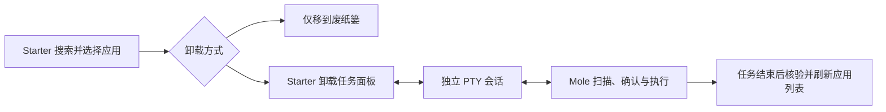

# 卸载工具集成设计

2026-10-10 · 设计依据与首版实现记录。

采用 **Starter 自己的任务面板 + 独立 PTY 会话 + Mole**。Starter 负责应用搜索、窗口、主题和任务生命周期；Mole 负责关联文件扫描、确认、权限交互和卸载。保留现有的“仅将应用移到废纸篓”操作。

用户明确要求：不打开或控制用户正在使用的终端，不启动 kitty、Terminal、iTerm 等外部终端应用。需要新窗口时，窗口也必须由 Starter 创建并使用 Starter 的视觉风格。首版已采用启动器窗口内的任务面板实现。

## 已验证的接口

本机安装的是 Homebrew 分发的 Mole 1.59.0。已运行 `mo --version`、`mo uninstall --help` 和只读的 `mo uninstall --list`；未执行卸载。

| 接口 | 行为 | 可用于 Starter 的部分 |
| --- | --- | --- |
| `mo uninstall` | 进入终端应用选择与批量卸载流程 | 后续可评估的批量入口 |
| `mo uninstall "Mac Explorer"` | 按名称匹配应用，并在终端确认 | 指定应用的卸载入口 |
| `mo uninstall --list` | 终端输出表格；stdout 接到管道时输出 JSON | 按应用路径对齐清单、显示大小和来源 |
| `mo uninstall --dry-run "Mac Explorer"` | 预演卸载；仍然包含终端交互 | 人工预览；不当作稳定的 GUI 数据接口 |

JSON 清单提供 `name`、`bundle_id`、`source`、`uninstall_name`、`path`、`size`。本机清单中 `CC Switch` 的 `uninstall_name` 是 `cc-switch`，但本机卸载匹配函数首先匹配显示名称或 `.app` 文件名，随后才做子串匹配。因此，不能未经验证就把 `uninstall_name` 当成可靠的应用标识。第一版使用经路径对齐的唯一完整显示名称或应用包名称；重复名称或无法唯一匹配时停止交接，并提供原生卸载。Mole 的无参数选择器能列出 Starter 自身，所以不作为自动后备入口。

目前检查到的卸载接口没有提供完整、稳定的“待删除文件 JSON + 按预览执行 + 结构化进度”协议。`--list` 中的大小是应用清单大小，不代表关联数据清理后的总量。第一版通过真正的终端模拟器展示 Mole 的终端界面，不从输出文本猜测待删除文件或自动确认。

早期只读的可行性验证使用 macOS 的 PTY 创建独立会话，子进程的 stdin/stdout/stderr 都被识别为终端，`mo uninstall --help` 正常输出并以 0 退出。这一步验证了进程连接方式。首版随后补充了下述输入、绘制和生命周期测试；真实 Mole 多选卸载及 sudo 交互尚未验证。

实现验证覆盖真实 PTY 的输入、stderr、退出码、尺寸调整、无回显输入、进程中断和清理；终端侧验证 ANSI 重绘、备用屏幕、分段 UTF-8、中文宽字符、平台输入法接口及滚动缓冲复制；GPUI 测试验证面板焦点、按键归属、重开与完成返回。另用原生 GPU 渲染截图检查 720×560 布局，并运行已安装 Mole 的只读 PTY 帮助命令。尚未对用户应用执行卸载或真实 sudo 提权。

## 推荐的第一版交互

输入 `/uninstall 微信`，选择应用后展示两个明确的操作：

- **卸载并清理关联文件**：Starter 切换到卸载任务面板，Mole 的文件清单、键盘确认和执行过程显示在面板中。
- **仅移到废纸篓**：沿用现有原生实现，保留应用配置和个人数据。

第一版只处理 Starter 已选择的单个应用。批量卸载留待能够继续保证自身与系统应用过滤时再评估。

界面沿用 Starter 的背景、边框、主题色和等宽字体。顶部显示“应用卸载”、所选应用和任务状态；中间是终端内容区；底部提供收起任务、停止任务和完成后返回等操作。第一版保留 Mole 实际要求的所有确认步骤，不另加 Starter 的重复删除确认，也不根据输出关键词自动发送 Enter 或 y。

优先使用启动器窗口内的任务面板。任务进行时，切走焦点不会结束任务；收起后再次呼出 Starter 应恢复该任务。若后续允许搜索与任务并行，再增加由 Starter 自己创建的独立任务窗口，复用同一组件。两种形式均不依赖外部终端应用。

Mole 未安装时说明当前缺少工具，保留原生卸载入口。若提供安装功能，也需要用户明确触发，并在 Starter 的同一任务界面中运行 Homebrew。

## 内嵌终端的组成

PTY 是操作系统提供的伪终端：给 Mole 一条独立的终端输入输出连接，不会启动图形终端应用，也不会接入用户已有的 shell 会话。

1. **任务会话**：创建具有独立控制终端和进程组的 PTY；按绝对路径启动 Mole，传入经过验证的应用参数，持续读取输出、写入按键，并提供窗口尺寸和退出通知。
2. **终端模拟器**：使用现成的 VT/ANSI 解析器维护屏幕网格、光标、滚动缓冲和备用屏幕。Mole 有转圈、清屏、光标移动和多选交互，普通日志文本框无法正确承载。
3. **GPUI 任务视图**：在 Starter 原生窗口内绘制终端网格，把 ANSI 基础颜色映射到当前主题，并负责键盘、选中复制、中文输入、宽字符和焦点处理。

实现采用 `portable-pty` 管理独立控制终端，`vt100` 维护终端屏幕与 2000 行滚动缓冲，GPUI 原生 canvas 绘制网格，`unicode-width` 处理输入法组合文本的宽度。基础 ANSI 颜色映射到 Starter 主题，256 色和 RGB 保留原值。终端输入通过 GPUI 的平台输入接口支持中文输入法；不引入 WebView。

第一版定位是**任务专用终端**：只运行 Starter 发起的 Mole 操作，结束后显示结果并返回；不提供通用 shell、标签页、分屏或用户 shell 配置管理。

## 实现边界

- 使用独立的 Mole 适配器处理工具发现、能力检查和清单读取；任务会话负责 PTY 与进程；任务视图负责原生绘制和交互。现有 macOS 原生卸载与 Windows 官方卸载入口保留各自职责。
- GUI 进程的 PATH 可能缺少 Homebrew 路径。检测 `/opt/homebrew/bin/mo`、`/usr/local/bin/mo`、用户安装目录以及 PATH 中的 `mo`/`mole`；调用使用已解析的绝对路径。
- 按 `path` 对齐 Starter 与 Mole 的应用清单。Starter 自身和系统应用继续遵守现有过滤规则；只对可明确识别的完整名称进行直接交接。
- 直接以程序路径和参数列表启动 Mole，不经过用户的交互 shell，不拼接未经处理的搜索文本。设置可用的 PATH、UTF-8 locale、TERM 和终端尺寸，不加载用户 shell 初始化脚本。
- 按键发送到 PTY；方向键、空格、Enter、Esc 和 Ctrl+C 的含义由当前终端程序决定。任务获得焦点后，启动器的搜索快捷键不能抢走这些输入。与中文输入法组合状态协调。
- sudo 沿用 TTY 输入和关闭回显机制，不另设 Starter 密码框，不另外保存输入历史或记录密码。输入字节会短暂经过内存缓冲和队列；当前实现不承诺安全擦除。终端输出和滚动缓冲只在当前任务内保留；不自动写入日志或接入剪贴板历史。保持 Mole 默认的废纸篓行为。
- 收起视图和停止进程是不同操作。第一版可每次只运行一个卸载任务；运行中再次呼出窗口时恢复当前任务。停止操作向任务进程组发送正常中断信号；已完成的删除不会自动回滚。
- 子进程退出后读取退出状态，再核验目标路径并刷新应用清单。不能只凭启动成功或退出码 0 显示“卸载完成”，因为 Mole 内部可能保留部分文件。详细结果仍展示 Mole 的原始终端输出。
- JSON 清单扫描仅在启动卸载任务时放到后台执行，支持取消、超时和输出大小限制；不在每次输入字符时调用 Mole。旧版不支持该接口时解释原因，保留原生卸载，不自动进入无参数选择器。

## 其他方案

| 方案 | 优点 | 成本与限制 | 建议 |
| --- | --- | --- | --- |
| Starter 任务面板 + PTY + Mole | 复用清理规则与权限交互，所有操作留在 Starter | 需原生终端视图，内容保留 Mole 的终端布局 | 第一版采用 |
| Starter 独立任务窗口 + 同一组件 | 长任务与启动器搜索可以并行，视觉风格一致 | 多窗口焦点和任务管理增加复杂度 | 后续按需增加 |
| Starter 自己扫描并清理 | 完整的原生 GUI，可控制预览和保留项 | 持续维护应用规则、共享数据识别与 Homebrew 行为 | 暂缓 |
| Starter GUI + Mole 结构化后端 | 原生体验，同时复用 Mole 规则 | 需要上游新增或维护结构化接口 | 后续方向 |

第一版可以统一外壳、主题、字体与任务管理，Mole 内容仍是终端布局。若后续希望中间区域也成为原生复选文件列表、进度条和中文按钮，可以推动 Mole 增加按应用路径生成 JSON 预览、基于同一预览执行、输出 JSON Lines 进度与结果的接口。执行仍需重新核验路径和共享关系，且权限交互需单独设计。不要把 ANSI 终端输出解析成长期依赖的业务协议。

Mole 使用 GPL-3.0，本项目声明 MIT。建议保持独立安装、独立进程的外部工具边界；若未来复制 Mole 源码、修改或随安装包分发它，应针对对应分发方式落实 GPL 要求。

## 可推广的设计

采用“Starter 的工具入口 → 自有任务会话与界面 → 已安装的专业 CLI”的模式，之后可按需要增加 Homebrew 安装管理等任务。先完成 Mole 的具体适配，再从实际复用中提取共用能力，避免预先建立复杂插件框架。

## 来源

- [Mole README](https://github.com/tw93/Mole/blob/main/README.md)
- [Mole 卸载入口](https://github.com/tw93/Mole/blob/main/bin/uninstall.sh)
- [Mole 官方 Raycast / Alfred 终端集成](https://github.com/tw93/Mole/blob/main/scripts/setup-quick-launchers.sh)
- [Mole GPL-3.0 许可证](https://github.com/tw93/Mole/blob/main/LICENSE)
- 本机 `/opt/homebrew/Cellar/mole/1.59.0/libexec/bin/uninstall.sh` 的参数解析、JSON 清单和名称匹配实现。
